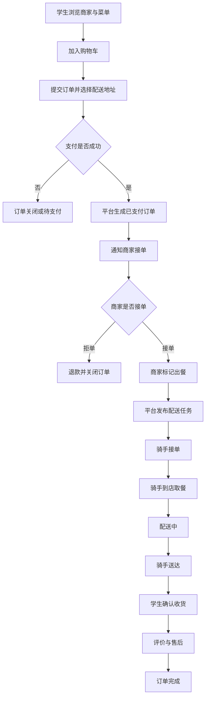

# 微服务开发与实践-校园外卖平台

> **课程**: 微服务开发与实践<br>**学号**: 2412190420<br>**仓库用途**: 用于上述课程的实践项目

## 项目简介

校园外卖平台是一个面向高校校园场景的外卖点餐与配送管理平台。平台连接学生、校园食堂/商家、兼职骑手和运营管理员，提供从浏览菜单、加入购物车、下单支付、商家接单、骑手配送到确认收货、评价售后的完整订单服务

## 业务背景

高校校园具有人员密集、用餐时间集中、校外外卖难以直接送达宿舍或教学区等特点。学生希望更方便地获取校园内餐饮；食堂和校园商家希望提高接单与出餐效率；兼职骑手希望有灵活的配送任务；运营方希望统一管理商家、订单、骑手和交易数据

因此，设计一个面向校园场景的外卖平台是有实际意义的。该平台以订单履约为核心，将商家、骑手、消费者和运营管理员连接起来，形成可追踪、可管理、可扩展的业务闭环

## 目标用户、用户角色与需求

| 用户角色 | 典型需求  |
|---|---|
| 学生 | 浏览商家与菜单、加购、下单、支付、查看配送进度、确认收货、评价、售后 |
| 商家/食堂 | 管理店铺与菜单、设置营业状态、接单/拒单、出餐、处理退款、查看经营数据 |
| 骑手 | 注册认证、接配送单、到店取餐、更新配送状态、送达、查看收入 |
| 运营管理员 | 审核商家、管理用户、管理订单、处理投诉、发布公告、查看统计 |
| 系统/平台 | 消息通知、状态流转、定时任务、监控告警、数据统计 |

## 选题原因

1. 校园外卖具有贴近大学生生活、使用频率高、易理解的场景
2. 包含学生、商家/食堂、骑手、运营管理员等多类角色
3. 订单履约流程包含支付、接单、配送、确认收货、评价等多个状态
4. 后续可自然演进到数据库持久化、服务拆分、认证、消息、事务、监控和部署
5. 功能边界清晰，适合在课程周期内逐步实现

## 项目目标与适用场景

项目目标是构建一个校园外卖业务平台，支持校园内餐饮商家、食堂窗口、学生和兼职骑手之间的点餐与配送协作

适用场景包括：

- 校园内商家外卖配送
- 宿舍生活区的校内配送
- 校园兼职骑手接单配送
- 平台运营方进行商家审核、订单管理和数据统计

## 功能模块划分

| 模块 | 具体功能 | 面向角色 |
|---|---|---|
| 账户与认证模块 | 注册、登录、退出、个人资料、角色绑定、地址管理、权限控制 | 全部角色 |
| 商家与菜单模块 | 商家入驻、店铺信息、营业状态、菜品分类、菜品管理、库存/售罄 | 商家、管理员 |
| 购物车与订单模块 | 加购、修改数量、结算、下单、订单查询、取消订单、状态流转 | 学生、商家 |
| 支付模块 | 支付、支付状态记录、退款记录、对账数据 | 学生、管理员 |
| 配送与骑手模块 | 骑手认证、配送任务发布、接单、取餐、送达、配送状态更新 | 骑手、管理员 |
| 评价与售后模块 | 评分、评论、投诉、售后申请、处理结果 | 学生、商家、管理员 |
| 通知消息模块 | 订单状态通知、商家通知、骑手通知、站内信、公告 | 全部角色 |
| 运营管理模块 | 用户管理、商家审核、订单管理、投诉管理、公告管理 | 管理员 |
| 统计与监控模块 | 订单量、销售额、活跃用户、商家排行、服务健康状态 | 管理员、商家 |
| 系统支撑模块 | 定时任务、日志、配置、异常处理、监控接入 | 系统 |

## 核心业务流程

### 订单履约主流程



## 运行环境

当前应用位于 `monolith`，已实现菜品查询、订单创建与查询，并使用 MySQL 持久化。直接在本机启动时的环境要求如下：

| 项目 | 要求 |
|---|---|
| JDK | 25 |
| Maven | 3.9+（仓库自带3.9.16版本） |
| Spring Boot | 4.0.8 |
| 端口 | 8080 |


## 启动与测试命令

以下命令均在 `monolith` 目录下执行：

```bash
cd monolith

# 启动应用（前台运行，Ctrl+C 停止）
./mvnw spring-boot:run

# 运行测试
./mvnw test
```

## Docker 容器化运行（week-05）

以下命令均在仓库根目录执行。需要 Docker Engine 与 Docker Compose v2；镜像构建在 Maven 容器内完成，无需本机安装 Maven 或 Java。

### 配置、构建与启动

```bash
# 首次创建配置；已有 .env 时不覆盖
cp -n .env.example .env
# 用编辑器填写 .env 中的 DB_PASSWORD、MYSQL_ROOT_PASSWORD
# DB_USERNAME 使用普通数据库账号，不要设置为 root

# 检查配置，再独立构建并查看镜像
# config --quiet 不输出解析后的密码
docker compose config --quiet
docker build -t campus-takeaway:week05 ./monolith
docker image ls campus-takeaway:week05

# 一键构建并后台启动应用与数据库
docker compose up -d --build
docker compose ps
docker compose logs --tail=100 app mysql
```

`monolith/Dockerfile` 以 Maven/JDK 25 镜像构建并运行测试，只将生成的 JAR 复制到 JRE 25 运行镜像，使用非 root 用户运行。`monolith/.dockerignore` 排除本地构建产物、IDE 配置与密码文件。

Compose 的构建上下文为 `./monolith`，应用镜像为 `campus-takeaway:week05`。`app` 与 `mysql` 共享 `campus-network`，应用通过服务名 `mysql:3306` 连接数据库。MySQL 使用 `8.4.11`，通过业务账号执行 `SELECT 1` 检查健康，应用等待数据库健康后启动。

| 变量 | 用途 |
|---|---|
| `APP_PORT` | 宿主机映射端口，默认 8080 |
| `DB_HOST` / `DB_PORT` | 容器内部数据库地址，保持 `mysql` / `3306` |
| `DB_USERNAME` / `DB_PASSWORD` | 自动创建的普通数据库账号及应用连接凭据 |
| `MYSQL_ROOT_PASSWORD` | MySQL root 密码，与应用账号独立 |

数据库名为 `campus_takeaway`。首次使用空数据卷启动时，MySQL 执行 `scripts/init.sql`，创建业务表与示例菜品。已有数据卷不会重新执行初始化脚本；修改 `.env` 中的密码不会自动修改已有数据库用户密码。实际 `.env` 被 Git 忽略，不应提交。

### 健康检查与业务 API

以下示例使用 Bash，在同一个终端依次执行。默认端口为 8080；若修改了 `.env` 中的 `APP_PORT`，同步修改 `BASE_URL`。应用启动需要时间，健康接口返回 HTTP 200 且 `status` 为 `UP` 后再执行业务请求。

```bash
BASE_URL=http://localhost:8080
curl -i "$BASE_URL/actuator/health"

# 查询商家 10 的上架菜品，预期 HTTP 200
curl -i "$BASE_URL/api/dishes?merchantId=10"

# 创建订单，预期 HTTP 201、totalAmount 为 25.00、status 为 PENDING_PAYMENT
# 初始菜品 1 的库存有限，重复运行会扣减库存
curl -i -X POST "$BASE_URL/api/orders" \
  -H 'Content-Type: application/json' \
  -d '{"userId":"student-1","merchantId":10,"items":[{"dishId":1,"quantity":2}],"deliveryAddress":"学生宿舍 1 幢 101 室","remark":"少辣"}'

# 输入本次创建响应中的 orderNo（不要使用初始化数据中的固定订单号）
read -r -p '粘贴刚创建的 orderNo: ' ORDER_NO
curl -i "$BASE_URL/api/orders/$ORDER_NO"
```

订单查询预期 HTTP 200，订单号、金额、状态、配送地址与明细应与创建结果一致。

### 数据持久化验证与停止

继续使用上一步终端中的 `BASE_URL` 和 `ORDER_NO`：

```bash
# 保存重建前的业务响应，临时目录由系统分配
VERIFY_DIR=$(mktemp -d)
curl -fSs "$BASE_URL/api/orders/$ORDER_NO" -o "$VERIFY_DIR/before.json"
cat "$VERIFY_DIR/before.json"

# 停止并删除容器、网络；命名数据卷保留
docker compose down
docker compose up -d
docker compose ps

# 等待健康接口返回 200 和 UP；尚未就绪时稍后重试
curl -i "$BASE_URL/actuator/health"

# 应用就绪后，查询同一条记录并比较重建前后的完整 JSON
curl -i "$BASE_URL/api/orders/$ORDER_NO"
curl -fSs "$BASE_URL/api/orders/$ORDER_NO" -o "$VERIFY_DIR/after.json"
diff -u "$VERIFY_DIR/before.json" "$VERIFY_DIR/after.json"

# 验证结束后停止服务
docker compose down
```

`diff` 无输出且退出码为 0 表示两份响应一致；只有前后查询均成功时才能判定验证通过。MySQL 数据挂载到命名卷 `mysql-data` 的 `/var/lib/mysql`，因此删除并重建容器后仍可读取原数据。持久化验证期间不要执行 `docker compose down -v`，它会删除数据卷。

本周配置说明、历史截图和当前版本待运行项目见 [week-05 实践记录](docs/homework/week-05/index.md)。本次目录调整后的镜像构建与运行结果需实际执行后补充。

## 接口访问地址

目前的应用启动后可访问以下接口：

| 接口 | 方法 | 访问地址 |
|---|---|---|
| 问候接口 | GET | http://localhost:8080/api/hello |
| 健康检查 | GET | http://localhost:8080/actuator/health |
| 菜品查询 | GET | http://localhost:8080/api/dishes?merchantId=10 |
| 创建订单 | POST | http://localhost:8080/api/orders |
| 学生订单列表 | GET | http://localhost:8080/api/orders?userId=student-1 |
| 订单详情 | GET | http://localhost:8080/api/orders/{orderNo} |

## 当前项目范围

### 当前范围

- 完成项目选题、业务背景、目标用户和功能规划
- 设计主要用户角色、权限边界和需求
- 设计功能模块、核心业务流程和订单状态
- 完成 [项目提案](docs/project-proposal.md)：项目名称、目标用户、优先业务场景与订单、菜品两个核心模型
- 实现 `monolith` 单体应用、问候接口、actuator 健康检查、菜品查询、订单创建、学生订单列表与订单详情
- 使用 MySQL 与 Spring Data JPA 持久化订单及明细，并提供容器化配置
- 规划后续数据库、服务拆分、认证、消息、事务、监控和部署方向

### 尚未实现的业务能力

[功能模块划分](#功能模块划分) 为完整规划，目前仅实现菜品查询和订单创建、查询等基础能力，登录认证、商家管理、支付及配送等模块仍待实现。

此外，以下能力也不在本课程当前实现范围内：

- 真实支付、真实退款等支付系统
- 真实地图导航、实时轨迹和路径规划
- 短信、微信、App 推送等真实消息通道
- 复杂推荐、搜索排序和广告系统
- 生产级安全、风控、审计和合规能力
- 高并发能力

## 初步项目边界

本项目聚焦校园内餐饮外卖的订单履约主链路，不追求完整商业外卖平台的全部能力。核心边界是：

1. 以校园内商家、食堂、学生和兼职骑手为主要参与者
2. 以订单状态流转和配送协作作为核心业务
3. 支付、地图、消息等能力初期可用模拟实现
4. 架构从单体开始，后续按课程任务逐步拆分和增强
