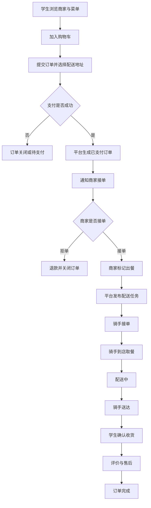

# 微服务开发与实践-校园外卖平台

> **课程**: 微服务开发与实践<br>**学号**: 2412190420<br>**仓库用途**: 用于上述课程的实践项目

## 项目简介

校园外卖平台是一个面向高校校园场景的外卖点餐与配送管理平台。平台连接学生、校园食堂/商家、兼职骑手和运营管理员，提供从浏览菜单、加入购物车、下单支付、商家接单、骑手配送到确认收货、评价售后的完整订单服务

## 业务背景

高校校园具有人员密集、用餐时间集中、校外外卖难以直接送达宿舍或教学区等特点。学生希望更方便地获取校园内餐饮；食堂和校园商家希望提高接单与出餐效率；兼职骑手希望有灵活的配送任务；运营方希望统一管理商家、订单、骑手和交易数据

因此，设计一个面向校园场景的外卖平台是有实际意义的。该平台以订单履约为核心，将商家、骑手、消费者和运营管理员连接起来，形成可追踪、可管理、可扩展的业务闭环

## 目标用户、用户角色与需求

| 用户角色 | 典型需求  |
|---|---|
| 学生 | 浏览商家与菜单、加购、下单、支付、查看配送进度、确认收货、评价、售后 |
| 商家/食堂 | 管理店铺与菜单、设置营业状态、接单/拒单、出餐、处理退款、查看经营数据 |
| 骑手 | 注册认证、接配送单、到店取餐、更新配送状态、送达、查看收入 |
| 运营管理员 | 审核商家、管理用户、管理订单、处理投诉、发布公告、查看统计 |
| 系统/平台 | 消息通知、状态流转、定时任务、监控告警、数据统计 |

## 选题原因

1. 校园外卖具有贴近大学生生活、使用频率高、易理解的场景
2. 包含学生、商家/食堂、骑手、运营管理员等多类角色
3. 订单履约流程包含支付、接单、配送、确认收货、评价等多个状态
4. 后续可自然演进到数据库持久化、服务拆分、认证、消息、事务、监控和部署
5. 功能边界清晰，适合在课程周期内逐步实现

## 项目目标与适用场景

项目目标是构建一个校园外卖业务平台，支持校园内餐饮商家、食堂窗口、学生和兼职骑手之间的点餐与配送协作

适用场景包括：

- 校园内商家外卖配送
- 宿舍生活区的校内配送
- 校园兼职骑手接单配送
- 平台运营方进行商家审核、订单管理和数据统计

## 功能模块划分

| 模块 | 具体功能 | 面向角色 |
|---|---|---|
| 账户与认证模块 | 注册、登录、退出、个人资料、角色绑定、地址管理、权限控制 | 全部角色 |
| 商家与菜单模块 | 商家入驻、店铺信息、营业状态、菜品分类、菜品管理、库存/售罄 | 商家、管理员 |
| 购物车与订单模块 | 加购、修改数量、结算、下单、订单查询、取消订单、状态流转 | 学生、商家 |
| 支付模块 | 支付、支付状态记录、退款记录、对账数据 | 学生、管理员 |
| 配送与骑手模块 | 骑手认证、配送任务发布、接单、取餐、送达、配送状态更新 | 骑手、管理员 |
| 评价与售后模块 | 评分、评论、投诉、售后申请、处理结果 | 学生、商家、管理员 |
| 通知消息模块 | 订单状态通知、商家通知、骑手通知、站内信、公告 | 全部角色 |
| 运营管理模块 | 用户管理、商家审核、订单管理、投诉管理、公告管理 | 管理员 |
| 统计与监控模块 | 订单量、销售额、活跃用户、商家排行、服务健康状态 | 管理员、商家 |
| 系统支撑模块 | 定时任务、日志、配置、异常处理、监控接入 | 系统 |

## 核心业务流程

### 订单履约主流程



## 当前实现与目录

默认入口为三个微服务，`monolith/` 为原单体应用。

| 服务 | 宿主机端口 | 职责 | 独立数据库 / 账号 |
|---|---|---|---|
| `user-service` | 8081 | 用户查询，返回有效或禁用状态 | `campus_user` / `user_app` |
| `dish-service` | 8082 | 菜品查询、批量校验、库存扣减与释放 | `campus_dish` / `dish_app` |
| `order-service` | 8083 | HTTP 编排下单、保存订单快照、订单查询与失败记录 | `campus_order` / `order_app` |

```text
monolith/                       原单体工程
services/{user,dish,order}-service/  三个独立 Spring Boot 工程
compose.yaml                    默认：Nacos + 三个应用 + 三个 MySQL
compose.monolith.yaml           单体应用 + 原 MySQL
scripts/microservices/          各服务的独立初始化 SQL
scripts/smoke-test.sh            健康与跨服务业务验证
docs/microservices-design.md     拆分设计
docs/homework/week-06/           第 06 周拆分实践与验收记录
docs/homework/week-07/           第 07 周 Nacos 部署与验证记录
```

## Docker 部署与测试

以下命令均在仓库根目录执行。需要 Docker Engine、支持 `--wait` 的 Docker Compose，以及 `openssl`、`curl`、`python3`。镜像内的 Maven/JDK 完成构建和测试，本机无需安装 Java 或 Maven。

### 1. 准备本地配置

```bash
cp -n .env.example .env
# 分别复制以下命令的输出到 .env 的 NACOS_AUTH_TOKEN 和 NACOS_AUTH_IDENTITY_VALUE
openssl rand -base64 32
openssl rand -hex 16
```

编辑根目录 `.env`，填写以下配置

| 配置 | 填写方式 |
|---|---|
| `USER_DB_PASSWORD`、`DISH_DB_PASSWORD`、`ORDER_DB_PASSWORD` | 三个数据库的业务账号密码 |
| `USER_MYSQL_ROOT_PASSWORD`、`DISH_MYSQL_ROOT_PASSWORD`、`ORDER_MYSQL_ROOT_PASSWORD` | 三个数据库的 root 密码 |
| `NACOS_AUTH_TOKEN` | 上述 Base64 输出，原始随机内容至少 32 字节 |
| `NACOS_AUTH_IDENTITY_KEY` | 保留模板中的 `campusTakeawayServerIdentity` 或设置自己的标识 |
| `NACOS_AUTH_IDENTITY_VALUE` | 上述十六进制随机值 |
| `NACOS_USERNAME` | 首次使用保留 `nacos` |
| `NACOS_PASSWORD` | 自行设置，下一步初始化管理员时使用同一密码 |
| `NACOS_NAMESPACE` | 初次实验留空，使用默认命名空间 |

### 2. 首次启动并初始化 Nacos

```bash
sudo docker compose config --quiet
sudo docker compose up -d nacos
sudo docker compose logs -f nacos
```

看到服务和控制台启动后，按 `Ctrl+C` 退出日志跟踪（容器仍继续运行），在浏览器打开 [Nacos 控制台](http://localhost:18080/)。首次访问时初始化 `nacos` 管理员密码，**必须与 `.env` 的 `NACOS_PASSWORD` 一致**，然后登录。

`NACOS_PASSWORD` 环境变量用于应用认证和 Compose 的登录健康检查，不会自动初始化管理员。初始化完成前，Nacos 容器可能显示 `unhealthy`；初始化后等待下一次健康检查，用 `sudo docker compose ps` 确认 Nacos 为 `healthy`，再启动全部应用。若持续未就绪，检查日志及管理员密码是否与 `.env` 一致。

| 本机入口 | 容器端口 | 用途 |
|---|---|---|
| `http://localhost:18080/` | `8080` | Nacos 3 控制台 |
| `localhost:8848` | `8848` | 服务端 HTTP API 与客户端寻址 |
| `localhost:9848` | `9848` | SDK gRPC 通信，不是浏览器页面 |

三个 Nacos 入口均绑定本机回环地址。Nacos 3 控制台使用独立的 `18080` 映射端口，不使用旧版的 `8848/nacos` 控制台地址。

### 3. 启动业务服务并确认注册

```bash
sudo docker compose up -d --build --wait
sudo docker compose ps
sudo docker compose config --services
```

启动结果应包含 Nacos、`user-service`、`dish-service`、`order-service` 和三个 MySQL，共 7 个服务。三个业务入口分别为 `http://localhost:8081`、`http://localhost:8082`、`http://localhost:8083`，各自提供 `/actuator/health`。

在 Nacos 控制台选择默认命名空间和 **`CAMPUS_TAKEAWAY_GROUP`**，确认三个服务均已注册，实例已启用且健康，地址和业务端口可从消费者容器访问。同一业务服务的多个实例使用相同的 `spring.application.name`。

如使用自定义命名空间，先在控制台创建，再把实际 Namespace ID 填入 `.env` 的 `NACOS_NAMESPACE`，重新执行上述启动命令使三个应用加载配置；在控制台切换到该命名空间查看注册结果。分组仍为 `CAMPUS_TAKEAWAY_GROUP`。

### 4. 从根目录运行冒烟检查

```bash
bash scripts/smoke-test.sh
```

三个 MySQL 使用 `mysql:8.4.11`，数据库端口只在容器网络中开放。所有服务加入 `campus-network`，通过 `NACOS_SERVER_ADDR=nacos:8848` 连接注册中心；应用分别连接 `user-db`、`dish-db`、`order-db`。订单服务每次通过 `DiscoveryClient` 获取 `user-service`、`dish-service` 的当前已知实例，再使用实例 URI 和原业务路径发送 HTTP 请求；这里只选择第一个实例，不实现负载均衡或自动重试。业务请求不经过 Nacos 转发。

MySQL 健康检查使用本实例业务账号执行 `SELECT 1`；应用健康接口检查自身数据库，订单启动时还等待用户、菜品服务健康。初始化 SQL 仅在空卷首次启动时执行。`nacos-data` 保存 Nacos 数据，`user-data`、`dish-data`、`order-data` 分别保存数据库文件。

冒烟脚本先检查 `http://localhost:18080/` 控制台和三个服务的健康接口，再实际创建一笔订单并扣减两份库存，默认使用 `student-1`、商家 10、菜品 1。它检查状态码、错误码、订单明细合并、金额、库存变化及失败后的数据，任一 HTTP 检查或断言失败均非零退出。重复执行会继续消耗库存，运行前确保测试菜品至少剩余两份。可通过 `NACOS_CONSOLE_URL`、`USER_BASE_URL`、`DISH_BASE_URL`、`ORDER_BASE_URL`、`SMOKE_USER_ID`、`SMOKE_MERCHANT_ID`、`SMOKE_DISH_ID` 覆盖默认值。

控制台可打开、实例已注册与业务调用成功是不同检查。停服恢复和业务数据验证另见下文及 [第 07 周记录](docs/homework/week-07/index.md)。启动或检查失败时查看：

```bash
sudo docker compose ps
sudo docker compose logs --tail=100 nacos user-service dish-service order-service
```

### 5. 后续启动与停止

完成首次初始化后，后续启动可直接执行：

```bash
sudo docker compose up -d --build --wait
sudo docker compose ps
bash scripts/smoke-test.sh
```

停止系统使用 `sudo docker compose down`，保留 Nacos 数据卷时无需重复初始化管理员。修改 `.env` 不会自动修改已有卷中的 MySQL 密码或 Nacos 管理员密码，需要同步修改实际账号密码。`down -v` 会删除包括 Nacos 在内的实验数据卷。

## 业务 API

| 服务 | 方法和路径 | 用途 |
|---|---|---|
| 各服务 | `GET /actuator/health` | 本服务及其数据库健康 |
| 用户 :8081 | `GET /api/users/{userId}` | 用户 ID、展示名和状态 |
| 菜品 :8082 | `GET /api/dishes?merchantId=10` | 商家上架菜品 |
| 菜品 :8082 | `POST /internal/dishes/validate` | 批量预校验，不扣库存 |
| 菜品 :8082 | `POST /internal/stock-operations/{orderNo}/deduct` | 原子批量扣减并返回价格快照 |
| 菜品 :8082 | `PUT /internal/stock-operations/{orderNo}/release` | 幂等释放或保存释放终态 |
| 菜品 :8082 | `GET /internal/stock-operations/{orderNo}` | 核对操作状态和明细 |
| 订单 :8083 | `POST /api/orders` | 创建待支付订单 |
| 订单 :8083 | `GET /api/orders?userId=student-1` | 本地订单列表 |
| 订单 :8083 | `GET /api/orders/{orderNo}` | 本地历史快照详情 |

订单通过 `RestTemplate` 顺序查询用户、预校验菜品、扣减库存，再提交本地订单事务。总额使用扣减响应的价格快照计算；订单查询只读取本地订单及明细。下单成功返回 201 和 `PENDING_PAYMENT`，用户、菜品不存在返回 404，禁用或业务冲突返回 409，依赖连接失败返回 503，超时返回 504，异常依赖响应返回 502。错误响应使用带稳定 `code` 的 `ProblemDetail`，生成操作号后附带 `orderNo`。

## 独立工程测试

安装 JDK 25 和 Maven 3.9+ 后，在仓库根目录分别进入各工程执行测试：

```bash
(cd services/user-service && mvn test)
(cd services/dish-service && mvn test)
(cd services/order-service && mvn test)
```

每条命令在子 Shell 中切换目录，执行后仍位于仓库根目录。测试通过 `test` Profile 使用 H2 并关闭 Nacos 服务发现和自动注册；订单测试模拟 `DiscoveryClient` 和远程 HTTP 响应，不依赖真实 Nacos 或 MySQL。

## 故障演示与恢复

以下为可复现的依赖停止验证步骤，成功启动三个服务后执行：

```bash
sudo docker compose stop user-service
curl -i -X POST http://localhost:8083/api/orders \
  -H 'Content-Type: application/json' \
  -d '{"userId":"student-1","merchantId":10,"items":[{"dishId":1,"quantity":1}],"deliveryAddress":"故障验证宿舍"}'
# 预期 503 / DEPENDENCY_UNAVAILABLE，预校验失败，不创建下单记录或业务订单。
sudo docker compose up -d --wait user-service
```

停止后在 Nacos 控制台观察实例列表随后变化；SDK 可能短暂保留旧地址，无实例或旧地址连接失败应返回 503。恢复后等待实例重新注册且业务接口可访问，再提交正常请求。将停止和恢复对象改成 `dish-service` 可复现菜品依赖故障。服务恢复后可以重新运行冒烟脚本。运行期失败由 HTTP 客户端处理，启动依赖不会替代业务校验。

库存扣减明确成功而本地订单保存失败时，会出现“远端成功、本地失败”的窗口。订单服务先核对本地提交结果，确认无订单后以同一 `orderNo` 释放库存；释放成功记录 `FAILED`，释放失败或提交结果无法确认记录 `RECOVERY_REQUIRED` 并返回 503。相同操作号不重复扣减或回补；释放先到会保存 `RELEASED` 终态以拒绝迟到扣减。

人工核对时先确认原下单请求已结束，再查询本地订单和库存操作：有有效订单且操作为 `DEDUCTED` 时保留库存扣减；确认无有效订单而操作仍为 `DEDUCTED` 时，通过释放 API 重试补偿，再在订单库记录核对依据及处理结果。订单查询或数据库状态无法确认时继续核对，不直接释放。恢复步骤和边界详见 [设计文档的一致性处理](docs/microservices-design.md#62-失败与补偿)。

## 数据持久化复现

下面使用本次验收订单，比较容器重建前后的同一订单和菜品响应。运行期间不提交其他订单。

```bash
VERIFY_DIR=$(mktemp -d)
ORDER_NO=34aace04-b269-4278-89d5-741ff214ca6e
curl -fSs "http://localhost:8083/api/orders/$ORDER_NO" -o "$VERIFY_DIR/order-before.json"
curl -fSs 'http://localhost:8082/api/dishes?merchantId=10' -o "$VERIFY_DIR/dishes-before.json"
sudo docker compose down
sudo docker compose up -d --wait
curl -fSs "http://localhost:8083/api/orders/$ORDER_NO" -o "$VERIFY_DIR/order-after.json"
curl -fSs 'http://localhost:8082/api/dishes?merchantId=10' -o "$VERIFY_DIR/dishes-after.json"
diff -u "$VERIFY_DIR/order-before.json" "$VERIFY_DIR/order-after.json"
diff -u "$VERIFY_DIR/dishes-before.json" "$VERIFY_DIR/dishes-after.json"
```

前后查询均成功且两个 `diff` 无输出时，说明该订单和库存保持一致。普通 `down` 保留三个数据库及 Nacos 命名卷；`down -v` 会删除数据卷。停止微服务使用 `sudo docker compose down`。

## 保留的单体版本

`monolith/` 仍包含原源码、POM 和 Dockerfile，原 `scripts/init.sql`、`scripts/reset.sql` 对应 `campus_takeaway`。单体 Compose 入口为 [compose.monolith.yaml](compose.monolith.yaml)，端口默认 8080，沿用命名卷 `mysql-data`。

运行前需在 `.env` 中补充示例文件末尾的 `MYSQL_ROOT_PASSWORD`、`DB_USERNAME`、`DB_PASSWORD`。然后执行：

```bash
sudo docker compose down
sudo docker compose -f compose.monolith.yaml config --quiet
sudo docker compose -f compose.monolith.yaml up -d --build
curl -i http://localhost:8080/actuator/health
sudo docker compose -f compose.monolith.yaml down
```

本机直接运行时配置单体数据库连接，执行 `mvn -f monolith/pom.xml spring-boot:run`；测试命令为 `mvn -f monolith/pom.xml test`。历史容器化记录见 [week-05](docs/homework/week-05/index.md)，当前默认启动流程以本 README 的微服务命令为准。

## 当前项目范围

### 当前范围

- 完成项目选题、业务背景、目标用户和功能规划
- 设计主要用户角色、权限边界和需求
- 设计功能模块、核心业务流程和订单状态
- 完成 [项目提案](docs/project-proposal.md)：项目名称、目标用户、优先业务场景与订单、菜品两个核心模型
- 实现 `monolith` 单体应用、问候接口、actuator 健康检查、菜品查询、订单创建、学生订单列表与订单详情
- 使用 MySQL 与 Spring Data JPA 持久化订单及明细，并提供容器化配置
- 拆分用户、菜品、订单三个独立应用和数据库，实现 RestTemplate 调用、库存幂等、失败补偿及恢复记录
- 完成微服务 Compose 部署与健康、成功下单、依赖资源不存在及用户禁用的冒烟验收
- 规划后续认证、消息、事务恢复和监控方向

### 尚未实现的业务能力

[功能模块划分](#功能模块划分) 为完整规划，目前已实现用户查询、菜品查询、跨服务下单和订单查询等基础能力，登录认证、商家管理、支付及配送等模块仍待实现。

此外，以下能力也不在本课程当前实现范围内：

- 真实支付、真实退款等支付系统
- 真实地图导航、实时轨迹和路径规划
- 短信、微信、App 推送等真实消息通道
- 复杂推荐、搜索排序和广告系统
- 生产级安全、风控、审计和合规能力
- 高并发能力

## 初步项目边界

本项目聚焦校园内餐饮外卖的订单履约主链路，不追求完整商业外卖平台的全部能力。核心边界是：

1. 以校园内商家、食堂、学生和兼职骑手为主要参与者
2. 以订单状态流转和配送协作作为核心业务
3. 支付、地图、消息等能力初期可用模拟实现
4. 架构从单体开始，后续按课程任务逐步拆分和增强
