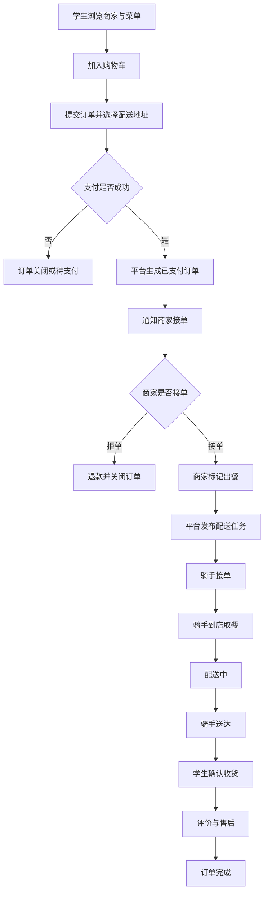

# 微服务开发与实践-校园外卖平台

> **课程**: 微服务开发与实践<br>**学号**: 2412190420<br>**仓库用途**: 用于上述课程的实践项目

## 项目简介

校园外卖平台是一个面向高校校园场景的外卖点餐与配送管理平台。平台连接学生、校园食堂/商家、兼职骑手和运营管理员，提供从浏览菜单、加入购物车、下单支付、商家接单、骑手配送到确认收货、评价售后的完整订单服务

## 业务背景

高校校园具有人员密集、用餐时间集中、校外外卖难以直接送达宿舍或教学区等特点。学生希望更方便地获取校园内餐饮；食堂和校园商家希望提高接单与出餐效率；兼职骑手希望有灵活的配送任务；运营方希望统一管理商家、订单、骑手和交易数据

因此，设计一个面向校园场景的外卖平台是有实际意义的。该平台以订单履约为核心，将商家、骑手、消费者和运营管理员连接起来，形成可追踪、可管理、可扩展的业务闭环

## 目标用户、用户角色与需求

| 用户角色 | 典型需求  |
|---|---|
| 学生 | 浏览商家与菜单、加购、下单、支付、查看配送进度、确认收货、评价、售后 |
| 商家/食堂 | 管理店铺与菜单、设置营业状态、接单/拒单、出餐、处理退款、查看经营数据 |
| 骑手 | 注册认证、接配送单、到店取餐、更新配送状态、送达、查看收入 |
| 运营管理员 | 审核商家、管理用户、管理订单、处理投诉、发布公告、查看统计 |
| 系统/平台 | 消息通知、状态流转、定时任务、监控告警、数据统计 |

## 选题原因

1. 校园外卖具有贴近大学生生活、使用频率高、易理解的场景
2. 包含学生、商家/食堂、骑手、运营管理员等多类角色
3. 订单履约流程包含支付、接单、配送、确认收货、评价等多个状态
4. 后续可自然演进到数据库持久化、服务拆分、认证、消息、事务、监控和部署
5. 功能边界清晰，适合在课程周期内逐步实现

## 项目目标与适用场景

项目目标是构建一个校园外卖业务平台，支持校园内餐饮商家、食堂窗口、学生和兼职骑手之间的点餐与配送协作

适用场景包括：

- 校园内商家外卖配送
- 宿舍生活区的校内配送
- 校园兼职骑手接单配送
- 平台运营方进行商家审核、订单管理和数据统计

## 功能模块划分

| 模块 | 具体功能 | 面向角色 |
|---|---|---|
| 账户与认证模块 | 注册、登录、退出、个人资料、角色绑定、地址管理、权限控制 | 全部角色 |
| 商家与菜单模块 | 商家入驻、店铺信息、营业状态、菜品分类、菜品管理、库存/售罄 | 商家、管理员 |
| 购物车与订单模块 | 加购、修改数量、结算、下单、订单查询、取消订单、状态流转 | 学生、商家 |
| 支付模块 | 支付、支付状态记录、退款记录、对账数据 | 学生、管理员 |
| 配送与骑手模块 | 骑手认证、配送任务发布、接单、取餐、送达、配送状态更新 | 骑手、管理员 |
| 评价与售后模块 | 评分、评论、投诉、售后申请、处理结果 | 学生、商家、管理员 |
| 通知消息模块 | 订单状态通知、商家通知、骑手通知、站内信、公告 | 全部角色 |
| 运营管理模块 | 用户管理、商家审核、订单管理、投诉管理、公告管理 | 管理员 |
| 统计与监控模块 | 订单量、销售额、活跃用户、商家排行、服务健康状态 | 管理员、商家 |
| 系统支撑模块 | 定时任务、日志、配置、异常处理、监控接入 | 系统 |

## 核心业务流程

### 订单履约主流程



## 当前实现与目录

默认入口为三个独立的 Spring Boot 微服务，`monolith/` 为原单体应用。三个服务各自拥有数据库，并注册到 Nacos；订单服务通过服务发现调用用户、菜品服务

| 服务 | 宿主机端口 | 职责 | 独立数据库 / 账号 |
|---|---|---|---|
| `gateway-service` | 8080 | 对外入口、服务名路由与 JWT 校验 | 无 |
| `user-service` | 8081 | 登录、用户查询，返回有效或禁用状态 | `campus_user` / `user_app` |
| `dish-service` | 8082 | 菜品查询、批量校验、库存扣减与释放 | `campus_dish` / `dish_app` |
| `order-service` | 8083 | 下单、保存订单快照、订单查询与失败记录 | `campus_order` / `order_app` |

```text
monolith/                 原单体工程
services/                 网关、用户、菜品和订单四个独立 Spring Boot 工程
compose.yaml              微服务编排
compose.scale.yaml        原多实例编排
compose.monolith.yaml     单体应用 + 原 MySQL
scripts/                  数据库初始化 SQL 与冒烟测试脚本
docs/                     设计文档与各周实践记录
```

## Docker 部署与运行

以下命令均在仓库根目录执行。需要 Docker Engine、支持 `--wait` 的 Docker Compose，以及 `openssl`、`curl`、`python3`；应用的构建与测试在镜像内完成，本机无需安装 Java 或 Maven

### 1. 配置环境变量

```bash
cp -n .env.example .env
openssl rand -base64 32   # 填入 NACOS_AUTH_TOKEN
openssl rand -hex 16      # 填入 NACOS_AUTH_IDENTITY_VALUE
openssl rand -base64 64 | tr -d '\n'; printf '\n'  # 填入 JWT_SECRET
```

### 2. 首次启动并初始化 Nacos

```bash
sudo docker compose up -d nacos
```

> [!WARNING]
> `NACOS_PASSWORD` 仅用于应用认证和 Compose 健康检查，不会自动初始化管理员账户，管理员账户需手动在网页控制台中手动初始化

浏览器打开 [Nacos 控制台](http://localhost:18080/)，首次访问时初始化 `nacos` 管理员密码，**必须与 `.env` 的 `NACOS_PASSWORD` 一致**，然后输入用户名和密码登录

> [!NOTE]
> 为避免端口冲突，控制台使用独立的 `18080` 映射端口

Nacos 需使用三个端口：`http://localhost:18080/`（控制台）、`localhost:8848`（服务端 HTTP API）、`localhost:9848`（SDK gRPC，非浏览器页面），均只绑定回环地址。容器内应用需通过 `nacos:8848` 访问注册中心

### 3. 启动全部服务&验证健康状态


```bash
sudo docker compose up -d --build --wait
sudo docker compose ps
```

启动结果应包含 Nacos、网关、三个业务服务、三个 MySQL。统一业务入口是 `http://localhost:8080`（默认）；外部健康检查使用网关的 `/actuator/health`。

在 Nacos 控制台选择默认命名空间（或 `.env` 中配置的命名空间）和 `CAMPUS_TAKEAWAY_GROUP`，确认网关和三个业务服务均已注册、实例已启用且健康。

> [!NOTE]
> 使用自定义命名空间时，需要先在Nacos控制台创建，再把实际 Namespace ID 填入 `.env` 的 `NACOS_NAMESPACE`中，重新执行启动命令

认证脚本不修改订单或库存。冒烟脚本则实际创建一笔订单、消耗两份库存，核对订单快照与库存变化，同时验证跨用户下单 `403` 和本人请求不存在菜品 `404` 不改变数据。可设置 `GATEWAY_URL`、`NACOS_CONSOLE_URL`、`SMOKE_MERCHANT_ID` 和 `SMOKE_DISH_ID`。运行脚本前请确保测试菜品库存足够。

### 4. 停止服务

使用 `sudo docker compose down`，数据会得到保留

> [!CAUTION]
> 使用 `sudo docker compose down -v` 会删除全部数据卷，谨慎使用


## 网关 API 与测试账号

网关启动配置和四条路由均在根目录 [compose.yaml](compose.yaml) 的 `gateway-service` 下声明；路由由 `SPRING_APPLICATION_JSON` 注入网关。访问规则见[网关路由与角色权限](docs/security.md#网关路由与角色权限)。

| 登录名 | 角色 | 业务身份 / 初始密码来源 |
|---|---|---|
| `student1` | `STUDENT` | `student-1` / `DEMO_STUDENT_PASSWORD` |
| `admin` | `ADMIN` | `admin`（独立的管理员用户行） / `DEMO_ADMIN_PASSWORD` |

登录名、角色和 BCrypt 密码哈希保存在 `users` 表

| 路由 | 规则 |
|---|---|
| `GET /actuator/health` | 网关健康检查，无需登录 |
| `POST /api/auth/login` | 无需 token；凭证错误或学生账户停用返回 `401` |
| `GET /api/users/{userId}` | 学生只能查本人，管理员可跨用户查询 |
| `GET /api/dishes?merchantId=10` | 登录后可查 |
| `POST /api/orders` | 仅学生可给本人下单 |
| `GET /api/orders?userId=student-1`、`GET /api/orders/{orderNo}` | 学生只能查自己的订单，管理员可跨用户查询 |
| `POST /internal/stock/deduct` | 网关不转发；仅供订单服务在容器网络内通过 Feign 调用 |

以学生身份登录并调用受保护 API：

```bash
curl -i -X POST http://localhost:8080/api/auth/login \
  -H 'Content-Type: application/json' \
  -d '{"username":"student1","password":"替换为学生密码"}'
curl -i http://localhost:8080/api/users/student-1 \
  -H 'Authorization: Bearer 替换为返回的 token'
```

## 运行测试

安装 JDK 25 和 Maven 3.9+ 后，在仓库根目录分别进入各工程执行测试：

```bash
(cd services/user-service && mvn test)
(cd services/dish-service && mvn test)
(cd services/order-service && mvn test)
(cd services/gateway-service && mvn test)
```

## 保留的单体版本

`monolith/` 保留原源码、POM 和 Dockerfile，沿用 `campus_takeaway` 数据库（初始化脚本为 `scripts/init.sql`、`scripts/reset.sql`）与命名卷 `mysql-data`，Compose 入口为 [compose.monolith.yaml](compose.monolith.yaml)，默认端口 8080。切换前先停止微服务，并在 `.env` 中补充示例文件末尾的 `MYSQL_ROOT_PASSWORD`、`DB_USERNAME`、`DB_PASSWORD`：

```bash
sudo docker compose down
sudo docker compose -f compose.monolith.yaml config --quiet
sudo docker compose -f compose.monolith.yaml up -d --build
curl -i http://localhost:8080/actuator/health
sudo docker compose -f compose.monolith.yaml down
```

本机直接运行时配置单体数据库连接，执行 `mvn -f monolith/pom.xml spring-boot:run`；测试命令为 `mvn -f monolith/pom.xml test`。历史容器化记录见 [week-05](docs/homework/week-05/index.md)，当前默认启动流程以本文的微服务命令为准

## 当前项目进度

当前已在第 07 周 Nacos 服务注册与发现基础上，编写第 08 周 OpenFeign 与负载均衡实现；第 08 周部署与测试待使用者运行。累计进度如下：

- 完成项目选题、业务背景、目标用户、功能模块和订单状态设计
- 完成 [项目提案](docs/project-proposal.md)：项目名称、目标用户、优先业务场景与订单、菜品两个核心模型
- 实现 `monolith` 单体应用、问候接口、actuator 健康检查、菜品查询、订单创建、学生订单列表与订单详情
- 使用 MySQL 与 Spring Data JPA 持久化订单及明细，并提供容器化配置
- 拆分用户、菜品、订单三个独立服务与数据库，实现 RestTemplate 调用、库存幂等、失败补偿及恢复记录
- 接入 Nacos 3.2.4 服务注册与发现：三个服务注册到 `CAMPUS_TAKEAWAY_GROUP`，订单服务按实例 URI 动态调用用户、菜品服务，已移除固定地址配置
- 第 08 周改用 OpenFeign + LoadBalancer，保留超时、错误映射和补偿机制，新增双实例 Compose、Feign 测试及端到端脚本
- 完成微服务 Compose 部署与健康、成功下单、依赖资源不存在及用户禁用的冒烟验收；三个工程共 43 个测试通过
- 接入 JWT 登录与网关角色鉴权

### 尚未实现

[功能模块划分](#功能模块划分) 为完整规划。目前已实现网关登录认证、角色鉴权、用户查询、菜品查询、跨服务下单和订单查询；商家管理、支付及配送等模块仍待实现。

微服务治理方面，当前使用 Spring Cloud LoadBalancer 选择发现到的实例；为避免写操作超时后重复执行，显式关闭自动重试。熔断未启用，配置中心和跨服务事务尚未实现；扣减与保存订单之间的故障需人工核对。以下能力也不在本课程当前实现范围内：

- 真实支付、真实退款等支付系统
- 真实地图导航、实时轨迹和路径规划
- 短信、微信、App 推送等真实消息通道
- 复杂推荐、搜索排序和广告系统
- 生产级安全、风控、审计和合规能力
- 高并发能力

## 初步项目边界

本项目聚焦校园内餐饮外卖的订单履约主链路，不追求完整商业外卖平台的全部能力。核心边界是：

1. 以校园内商家、食堂、学生和兼职骑手为主要参与者
2. 以订单状态流转和配送协作作为核心业务
3. 支付、地图、消息等能力初期可用模拟实现
4. 架构从单体开始，后续按课程任务逐步拆分和增强
