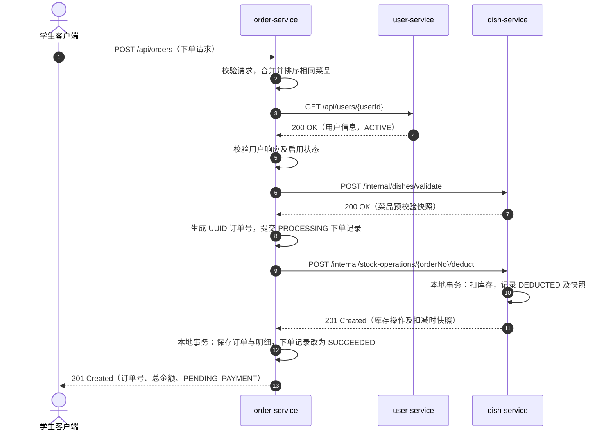

# 服务间通信：下单业务调用链路

## 1. 业务场景与范围

选择学生提交订单这一业务流程，入口为订单服务的 `POST /api/orders`。本文以当前 `services/` 下的微服务实现为准，展示首次下单且全部调用成功的路径：用户存在且状态为 `ACTIVE`，菜品属于指定商家、处于上架状态、库存充足，数据库提交成功。

请求包含 `userId`、`merchantId`、`items`、`deliveryAddress` 和可选的 `remark`。成功响应为 `201 Created`，响应体包含 `orderNo`、`totalAmount`、`status`，初始订单状态为 `PENDING_PAYMENT`，并返回指向 `/api/orders/{orderNo}` 的 `Location`。本流程止于创建待支付订单，不包含尚未实现的支付、商家接单或配送。

### 服务职责

| 参与方 | 本次下单中的职责 |
| --- | --- |
| order-service | 接收请求、编排用户及菜品校验、生成订单号、记录下单尝试、保存订单与明细 |
| user-service | 查询用户，返回用户信息与状态；是否允许下单由订单侧 `UserClient.requireActive` 判断 |
| dish-service | 预校验菜品；在本地事务中幂等扣减库存，保存库存操作及菜品快照 |
| Nacos + Spring Cloud LoadBalancer | Nacos 提供服务发现，LoadBalancer 从发现的服务实例中选择调用目标 |

## 2. 调用时序图

## 3. 链路中的关键约定

- **预校验不预留库存**：预校验通过后，库存仍可能变化，因此扣减事务必须加锁并重新校验。订单金额和订单明细取自扣减成功时返回的快照，而不是预校验快照或客户端报价。
- **三个独立的写事务**：先提交订单库的 `PROCESSING` 记录，再提交菜品库的库存扣减，最后提交订单、明细及 `SUCCEEDED`。没有覆盖两库及 HTTP 调用的全局事务。
- **幂等边界是库存操作**：订单号由订单服务生成，并作为库存操作号。相同操作号和相同请求重复扣减时返回已有结果（`200 OK`）；首次创建库存操作返回 `201 Created`。重复提交外部下单请求会生成新订单号，不能据此认定下单接口本身幂等。
- **服务发现与负载均衡**：服务以 `user-service`、`dish-service` 为目标名，使用相同的 Nacos namespace 和 `CAMPUS_TAKEAWAY_GROUP`。预校验与扣减可能命中不同菜品实例，由菜品服务共享数据库中的唯一操作号和行锁保证库存协调。
- **成功路径无补偿调用**：图中不执行 `release`。扣减结果未知或订单保存失败时，代码会进入提交结果核对、库存释放或 `RECOVERY_REQUIRED` 人工核对分支
