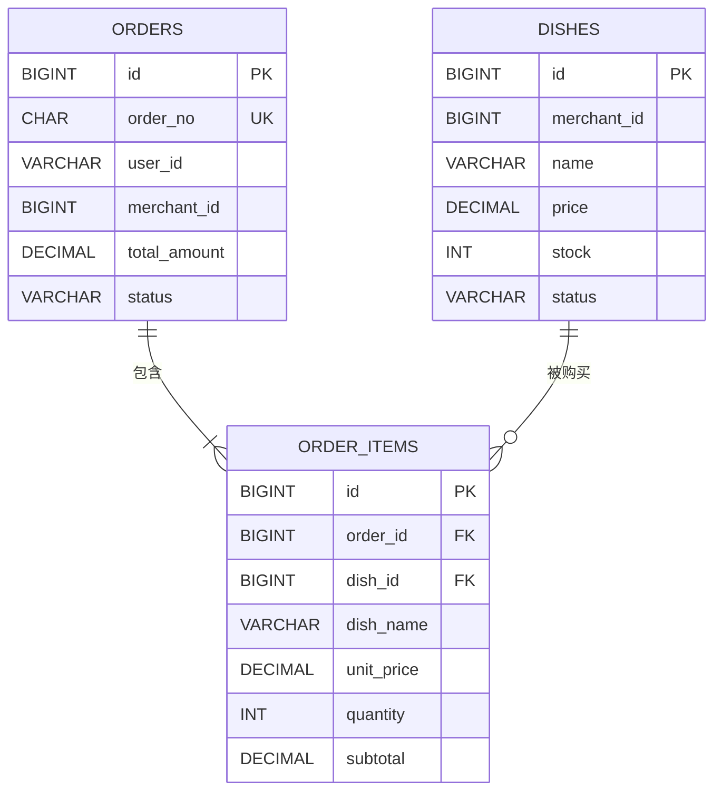

# 数据库设计：校园外卖平台

## 1. 设计范围

本文依据[项目提案](project-proposal.md)和 [week-04 实现文档](homework/week-04/index.md)，定义“学生提交订单”流程所需的数据库结构，作为后续代码编写的依据。

本周使用 MySQL 和 Spring Data JPA，设计以下三张业务表：

| 表名 | 对应实体 | 业务职责 |
|---|---|---|
| `dishes` | `Dish` | 保存菜品信息、当前售价、上架状态和库存 |
| `orders` | `Order` | 保存下单学生、商家、订单金额、状态和配送信息 |
| `order_items` | `OrderItem` | 关联订单与菜品，保存下单时的名称、单价、数量和小计快照 |

本周不建立用户表和商家表，仅记录 `user_id`、`merchant_id`，不为这两个字段设置指向用户表或商家表的外键。支付、接单、配送等后续业务字段暂不纳入本次设计。

## 2. 表之间的关系



- 订单与订单明细为 1:N：一张有效订单至少包含一条明细，每条明细只属于一张订单。通过 `order_items.order_id` 关联 `orders.id`。
- 菜品与订单明细为 1:N：一种菜品可以出现在多张订单的明细中，每条明细只关联一种菜品。通过 `order_items.dish_id` 关联 `dishes.id`。
- 订单与菜品通过订单明细形成 M:N：订单明细还承载数量和价格快照，因此作为独立实体建表。
- 同一商家的数据通过 `merchant_id` 标识：一张订单中的所有菜品必须属于该订单记录的商家，该规则由 Service 校验。

“订单至少包含一条明细”由请求校验及下单事务保证；外键只能保证明细引用的订单存在，不能单独保证每张订单都有明细。

## 3. 主要字段

### 3.1 菜品表 `dishes`

| 字段 | MySQL 类型 | 允许为空 | 约束与说明 |
|---|---|---|---|
| `id` | `BIGINT` | 否 | 主键，自增，唯一标识菜品 |
| `merchant_id` | `BIGINT` | 否 | 所属商家标识，本周不建立商家外键 |
| `name` | `VARCHAR(100)` | 否 | 菜品名称，应用层校验非空白 |
| `category` | `VARCHAR(64)` | 是 | 菜品分类，如主食、饮品 |
| `price` | `DECIMAL(19,2)` | 否 | 当前单价，必须大于等于 0 |
| `stock` | `INT` | 否 | 当前可售库存，必须大于等于 0；库存为 0 表示售罄 |
| `status` | `VARCHAR(32)` | 否 | `ON_SALE`（上架）或 `OFF_SALE`（下架） |

注：
1. 菜品通过初始化 SQL 准备，本周不提供菜品管理接口。菜品查询按商家和上架状态筛选；下单时还需要检查库存是否充足。

### 3.2 订单表 `orders`

| 字段 | MySQL 类型 | 允许为空 | 约束与说明 |
|---|---|---|---|
| `id` | `BIGINT` | 否 | 内部主键，自增，用于与订单明细关联 |
| `order_no` | `CHAR(36)` | 否 | 服务端生成的 UUID，采用标准带连字符格式，设置唯一约束，用于对外展示和查询 |
| `user_id` | `VARCHAR(64)` | 否 | 下单学生标识，应用层校验非空白，本周不查询用户表 |
| `merchant_id` | `BIGINT` | 否 | 接单商家标识，本周不建立商家外键 |
| `status` | `VARCHAR(32)` | 否 | 本周创建时固定为 `PENDING_PAYMENT`（待支付） |
| `total_amount` | `DECIMAL(19,2)` | 否 | 订单总金额，由服务端计算，必须大于等于 0 |
| `delivery_address` | `VARCHAR(255)` | 否 | 配送地址，应用层校验非空白 |
| `remark` | `VARCHAR(500)` | 是 | 下单备注 |
| `created_at` | `DATETIME(6)` | 否 | 应用创建订单时写入，对应 Java `LocalDateTime` |

注：
1. `id` 使用自增 `BIGINT`，用于数据库内部关联；`order_no` 使用 UUID，用于对外展示和订单详情查询。
2. `order_no` 设置 `NOT NULL` 和唯一约束。订单号唯一只保证订单号不重复，不代表本周已经实现重复请求幂等。

### 3.3 订单明细表 `order_items`

| 字段 | MySQL 类型 | 允许为空 | 约束与说明 |
|---|---|---|---|
| `id` | `BIGINT` | 否 | 主键，自增，唯一标识一条明细 |
| `order_id` | `BIGINT` | 否 | 外键，引用 `orders.id` |
| `dish_id` | `BIGINT` | 否 | 外键，引用 `dishes.id` |
| `dish_name` | `VARCHAR(100)` | 否 | 下单时的菜品名称快照 |
| `unit_price` | `DECIMAL(19,2)` | 否 | 下单时的单价快照，必须大于等于 0 |
| `quantity` | `INT` | 否 | 合并后的购买数量，必须大于 0 |
| `subtotal` | `DECIMAL(19,2)` | 否 | 明细小计，由服务端计算，必须大于等于 0 |

同一请求中的重复菜品先按 `dish_id` 合并数量，再生成明细。设计联合唯一约束 `(order_id, dish_id)`，保证同一张订单中每种菜品最多保存一条明细。

`dish_name`、`unit_price` 和 `subtotal` 为下单快照。订单详情直接读取明细中的快照，后续菜品改名或改价不会改变历史订单。

## 4. 主键、外键及必要约束

### 4.1 主键与唯一约束

| 表 | 约束 | 作用 |
|---|---|---|
| `dishes` | `PRIMARY KEY (id)`，`AUTO_INCREMENT` | 唯一标识菜品 |
| `orders` | `PRIMARY KEY (id)`，`AUTO_INCREMENT` | 唯一标识订单 |
| `order_items` | `PRIMARY KEY (id)`，`AUTO_INCREMENT` | 唯一标识订单明细 |
| `orders` | `UNIQUE (order_no)` | 保证作为对外订单号的 UUID 唯一 |
| `order_items` | `UNIQUE (order_id, dish_id)` | 防止同一订单重复保存同一种菜品的明细 |

### 4.2 外键约束

| 外键字段 | 引用字段 | 更新与删除策略 |
|---|---|---|
| `order_items.order_id` | `orders.id` | `ON UPDATE RESTRICT`、`ON DELETE RESTRICT` |
| `order_items.dish_id` | `dishes.id` | `ON UPDATE RESTRICT`、`ON DELETE RESTRICT` |

订单明细不能引用不存在的订单或菜品。存在引用时，限制删除对应订单或菜品，以保护历史记录；菜品停售通过设置 `OFF_SALE` 表示。

### 4.3 非空、取值与范围约束

- 字段表中标记“允许为空：否”的字段设置 `NOT NULL`。
- `price`、`unit_price`、`subtotal`、`total_amount` 设置非负检查约束。
- `stock` 设置 `CHECK (stock >= 0)`，`quantity` 设置 `CHECK (quantity > 0)`。
- 菜品状态限定为 `ON_SALE`、`OFF_SALE`；订单状态在本周暂限定为 `PENDING_PAYMENT`。
- 字符串非空白、标识格式及字段长度通过 Bean Validation 校验，因为 `NOT NULL` 不能拦截空字符串或纯空白字符串。

## 5. 查询索引

| 表 | 索引字段 | 支持的查询 |
|---|---|---|
| `dishes` | `(merchant_id, status, id)` | 查询指定商家的上架菜品，并按菜品 ID 排序 |
| `orders` |  `(order_no)` | 按对外订单号查询订单详情 |
| `orders` | `(user_id, created_at, id)` | 查询指定学生的订单，并按创建时间、ID 倒序排列 |
| `order_items` |  `(order_id, dish_id)` | 保证明细唯一，同时支持按订单 ID 查询明细 |
| `order_items` | `(dish_id)` | 支持菜品外键检查及关联查询 |

## 6. 金额、快照与事务一致性

下单时先合并重复菜品，再校验菜品存在、商家归属正确、处于上架状态且库存充足。全部通过后，服务端按数据库中的当前单价计算金额：

```text
明细小计 subtotal = 下单时单价 unit_price × 合并后数量 quantity
订单总金额 total_amount = 该订单全部明细 subtotal 之和
扣减后库存 stock = 原库存 − 合并后数量 quantity
```

金额使用 `BigDecimal` 计算，不使用 `float` 或 `double`。请求只提供菜品 ID 和数量，名称、单价、小计及总金额均由服务端确定。

订单总金额与多条明细之间的一致性、商家归属、至少一条明细等跨行或跨表业务规则由 Service 保证，不能仅依赖字段级检查约束。历史明细单价也不要求始终等于菜品表中的当前单价。

`OrderService.createOrder` 使用同一个 `@Transactional` 事务完成订单保存、明细保存和库存扣减，任一步骤失败时全部回滚。

本周不处理并发下单和重复请求幂等。自动化测试使用独立的 H2 配置；MySQL 中仍需验证真实建表约束、数据落库以及应用重启后订单可查询。
