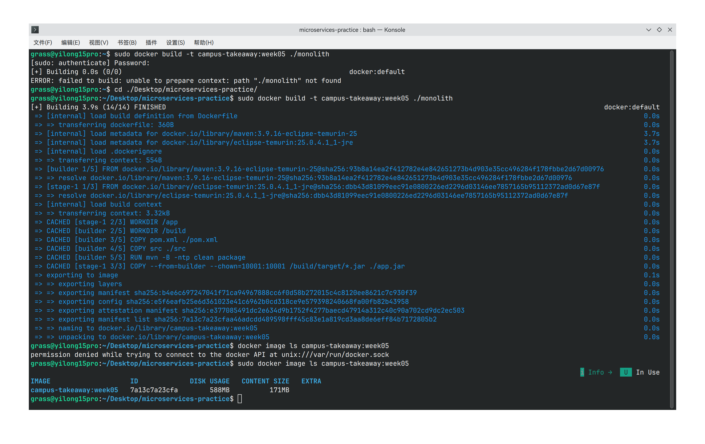
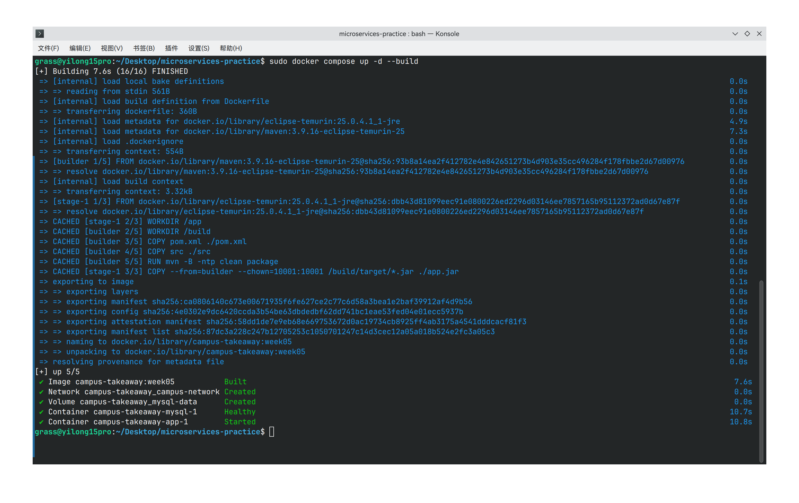
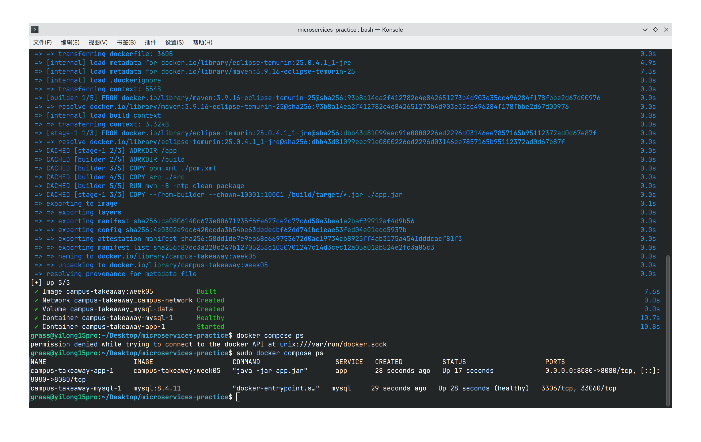
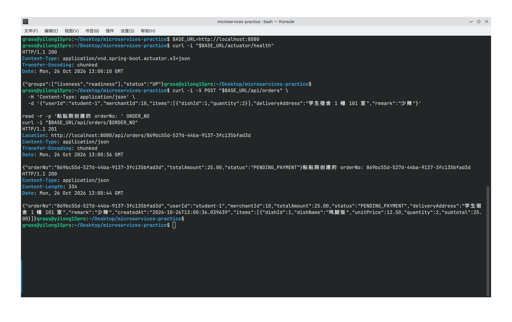

# week-05 Docker 容器化

## Dockerfile 与镜像构建

### 配置与原理

[monolith/Dockerfile](../../../monolith/Dockerfile)：Maven 3.9.16 / JDK 25 构建阶段执行 `mvn -B -ntp clean package`（包含测试），再将 JAR 复制到 JRE 25 运行阶段，使用 UID/GID 10001 运行。

[monolith/.dockerignore](../../../monolith/.dockerignore)：排除 `target`、IDE 配置、日志、`.env`、凭据与私钥等文件。

构建上下文仅包含 `monolith/`，构建由容器中的 Maven 和 JDK 完成，不依赖本机 Maven 或 Java，多阶段构建只保留 JAR 和 JRE，最终镜像不包含 Maven、源码与构建缓存，可减小运行镜像体积。

### 在仓库根目录执行

```bash
docker build -t campus-takeaway:week05 ./monolith
docker image ls campus-takeaway:week05
```




## 2. Compose 编排与启动

### 编排配置

[根目录 compose.yaml](../../../compose.yaml) 包含以下配置：

| 配置 | 内容 |
|---|---|
| app 镜像 | `campus-takeaway:week05`，构建上下文 `./monolith` |
| 数据库镜像 | `mysql:8.4.11` |
| 应用端口 | `${APP_PORT:-8080}:8080` |
| 服务网络 | 两个服务共享 `campus-network` bridge 网络 |
| 数据库连接 | `jdbc:mysql://${DB_HOST:-mysql}:${DB_PORT:-3306}/campus_takeaway` |
| 凭据 | `.env` 注入 `DB_USERNAME`、`DB_PASSWORD`、`MYSQL_ROOT_PASSWORD` |
| 数据持久化 | 命名卷 `mysql-data` 挂载到 `/var/lib/mysql` |
| 数据库初始化 | 只读挂载 `scripts/init.sql`，首次启动空卷时执行 |
| 启动依赖 | MySQL 使用业务账号执行 `SELECT 1`；app 等待 `service_healthy` |

应用通过 **Compose 服务名 `mysql`** 连接数据库；`localhost:8080` 是宿主机访问应用的地址。MySQL 没有向宿主机映射端口。Compose 文件未使用已废弃的 `version` 字段。

[.env.example](../../../.env.example) 中密码留空；复制后填写本地密码，`DB_USERNAME` 保持普通账号，不能使用 `root`。[.gitignore](../../../.gitignore) 排除实际 `.env`。已有数据卷中的账号密码不会随 `.env` 修改而自动变更。

### 在仓库根目录执行

```bash
cp -n .env.example .env
# 用编辑器填写 .env 的 DB_PASSWORD 和 MYSQL_ROOT_PASSWORD
# DB_HOST=mysql、DB_PORT=3306，DB_USERNAME 使用普通账号
docker compose config --quiet
docker compose up -d --build
docker compose ps
docker compose logs --tail=100 app mysql
```





## 3. 健康接口与个人业务 API 验证

以下命令在同一个 Bash 终端依次执行；如果修改了 `APP_PORT`，同步修改 `BASE_URL`。

```bash
BASE_URL=http://localhost:8080
curl -i "$BASE_URL/actuator/health"
```

等待应用就绪，预期 HTTP 200 且 JSON 的 `status` 为 `UP`。然后创建并查询订单：

```bash
curl -i -X POST "$BASE_URL/api/orders" \
  -H 'Content-Type: application/json' \
  -d '{"userId":"student-1","merchantId":10,"items":[{"dishId":1,"quantity":2}],"deliveryAddress":"学生宿舍 1 幢 101 室","remark":"少辣"}'

read -r -p '粘贴刚创建的 orderNo: ' ORDER_NO
curl -i "$BASE_URL/api/orders/$ORDER_NO"
```

首次空卷初始化提供商家 10 的菜品 1（鸡腿饭，单价 12.50）。创建预期返回 HTTP 201、总额 25.00、状态 `PENDING_PAYMENT` 与新生成的 `orderNo`；查询预期返回 HTTP 200，包含同一订单及明细。重复创建会扣减库存，库存不足时返回 409。



## 4. 数据持久化验证

继续使用上一步同一终端中的 `BASE_URL` 与本次创建的 `ORDER_NO`，保存前后响应：

```bash
VERIFY_DIR=$(mktemp -d)
curl -i "$BASE_URL/api/orders/$ORDER_NO"
curl -fSs "$BASE_URL/api/orders/$ORDER_NO" -o "$VERIFY_DIR/before.json"

docker compose down
docker compose up -d
docker compose ps

# 等待健康接口返回 HTTP 200 与 UP 后，再查询订单；未就绪时稍后重试
curl -i "$BASE_URL/actuator/health"
curl -i "$BASE_URL/api/orders/$ORDER_NO"
curl -fSs "$BASE_URL/api/orders/$ORDER_NO" -o "$VERIFY_DIR/after.json"
diff -u "$VERIFY_DIR/before.json" "$VERIFY_DIR/after.json"
```

判定条件：前后查询均为 HTTP 200；订单号、学生编号、商家编号、金额、状态、地址、创建时间和明细不变。完整 JSON 对比预期无差异，`diff` 无输出且退出码为 0。

`docker compose down` 删除容器与网络，但保留命名卷 `mysql-data`（默认完整卷名 `campus-takeaway_mysql-data`）。重新启动时 MySQL 挂载原卷读取数据库文件，因此新建订单可以保留。应用使用 `ddl-auto: validate`，不会在启动时重建业务表。验证期间不要执行 `docker compose down -v`，该命令会删除数据卷。


验证结束后可在根目录停止服务：

```bash
docker compose down
```
