# week-07 服务注册与发现

在第 06 周已拆分的校园外卖微服务基础上接入 Nacos 3.2.4：三个业务服务注册到同一命名空间与 `CAMPUS_TAKEAWAY_GROUP` 分组，订单服务在下单流程中通过 `DiscoveryClient` 获取用户服务、菜品服务的实例地址，再用实例 URI 发起真实 HTTP 调用。仓库结构、基础包名 `com.zjgsu.lht`、服务名、端口、数据归属和已有业务规则保持不变。

| 验收项 | 本次结果 |
|---|---|
| 注册中心 | Nacos `v3.2.4` standalone，启用鉴权，控制台 `http://localhost:18080/` |
| 注册服务 | `user-service`、`dish-service`、`order-service`，默认命名空间 `public`，分组 `CAMPUS_TAKEAWAY_GROUP`，各 1 个健康实例 |
| 调用方向 | `order-service` → `user-service`（用户校验）、`dish-service`（菜品校验与库存扣减） |
| 正常调用 | `POST http://localhost:8083/api/orders` 返回 201，金额 12.50，状态 `PENDING_PAYMENT` |
| 下线 | 停止 `user-service` 后实例从列表消失，同一请求返回 503 `DEPENDENCY_UNAVAILABLE`，订单列表不变 |
| 恢复 | 重新启动后实例重新注册，同一请求返回 201，健康接口恢复 UP |
| 脚本与测试 | 冒烟脚本退出码 0；三个工程共 43 个测试全部通过 |

## 1. 部署 Nacos 并注册服务

### 编排与初始化思路

[根 compose.yaml](../../../compose.yaml) 新增 `nacos` 服务，其余数据库与应用服务沿用第 06 周编排。Nacos 使用固定镜像 `nacos/nacos-server:v3.2.4`、`MODE=standalone`，按课堂方法启用鉴权：

| 配置项 | 取值或来源 | 作用 |
|---|---|---|
| `NACOS_AUTH_ENABLE` | `true` | 开启 Nacos 鉴权，客户端必须携带账号认证 |
| `NACOS_AUTH_TOKEN` | `.env` 中 Base64 随机值，原始内容至少 32 字节 | 服务端 Token 签名密钥 |
| `NACOS_AUTH_IDENTITY_KEY` / `NACOS_AUTH_IDENTITY_VALUE` | `.env`，Key 沿用模板默认值 `campusTakeawayServerIdentity`，Value 为随机十六进制 | 服务端身份标识，供服务端间请求校验 |
| `NACOS_PASSWORD` | `.env`，与首次在控制台初始化的 `nacos` 管理员密码一致 | 应用登录与服务健康检查使用，不负责自动初始化管理员 |
| `nacos-data` | 命名卷，挂载到 `/home/nacos/data` | 持久化 Nacos 数据与初始化后的管理员凭据 |

三个入口全部绑定本机回环地址，未暴露到公网：

| 本机入口 | 容器端口 | 用途 |
|---|---|---|
| `http://localhost:18080/` | `8080` | Nacos 3 控制台 WebUI |
| `localhost:8848` | `8848` | 服务端 HTTP API 与客户端寻址 |
| `localhost:9848` | `9848` | SDK gRPC 通信，不是浏览器页面 |

`.env` 已被 [.gitignore](../../../.gitignore) 忽略；[.env.example](../../../.env.example) 只保留 `NACOS_AUTH_TOKEN`、`NACOS_AUTH_IDENTITY_KEY`、`NACOS_AUTH_IDENTITY_VALUE`、`NACOS_USERNAME`、`NACOS_PASSWORD`、`NACOS_NAMESPACE` 等占位键，不含真实密钥与密码。截图中的控制台均以 `nacos` 用户登录，未展示密码或 Token。

Nacos 容器的健康检查调用 `/nacos/v3/auth/user/login` 并断言返回 `accessToken`，因此容器在管理员初始化完成前可能显示 `unhealthy`。首次启动顺序是：先只启动 Nacos，在控制台初始化管理员密码（与 `.env` 中 `NACOS_PASSWORD` 相同），确认健康后再启动业务服务。管理员初始化完成后，后续 `docker compose up -d` 直接复用 `nacos-data`，无需重复初始化；普通 `docker compose down` 保留该命名卷，`down -v` 会连同 Nacos 数据一起删除。

```bash
cp -n .env.example .env          # 填写数据库密码、NACOS_AUTH_TOKEN、NACOS_AUTH_IDENTITY_VALUE、NACOS_PASSWORD
sudo docker compose config --quiet
sudo docker compose up -d nacos
sudo docker compose logs -f nacos
# 浏览器打开 http://localhost:18080/ 初始化管理员密码，然后 Ctrl+C（仅退出日志跟踪，容器继续运行）
sudo docker compose ps           # 确认 nacos 为 healthy
```

### 各服务的注册配置

三个服务的 [application.yml](../../../services/order-service/src/main/resources/application.yml) 使用同一段注册配置，仅 `spring.application.name` 与端口不同：

```yaml
spring:
  application:
    name: order-service          # user-service / dish-service 各自不同
  cloud:
    nacos:
      discovery:
        server-addr: ${NACOS_SERVER_ADDR:localhost:8848}
        username: ${NACOS_USERNAME:nacos}
        password: ${NACOS_PASSWORD:}
        namespace: ${NACOS_NAMESPACE:}
        group: CAMPUS_TAKEAWAY_GROUP
```

Compose 为三个应用注入 `NACOS_SERVER_ADDR=nacos:8848`、`NACOS_USERNAME`、`NACOS_PASSWORD`、`NACOS_NAMESPACE`，容器内不使用 `localhost:8848`。应用端口由 `SERVER_PORT` 保持 8081、8082、8083，宿主机分别映射同号端口，互不冲突。

服务名沿用第 06 周方案，与 [microservices-design.md](../../microservices-design.md) 第 3 节一致：同一业务服务的多个实例必须使用相同的 `spring.application.name`，三个不同业务使用不同名称。三个 POM 均通过 `dependencyManagement` 引入课程使用的 `spring-cloud-dependencies:2025.1.0` 与 `spring-cloud-alibaba-dependencies:2025.1.0.0` BOM，只声明无版本号的 `spring-cloud-starter-alibaba-nacos-discovery`，未单独覆盖 Nacos Client 版本；本周未引入 Config Starter。

### 启动与注册结果

```bash
sudo docker compose up -d --build --wait
sudo docker compose ps
```

编排共 7 个服务：`nacos`、`user-service`、`dish-service`、`order-service` 与 `user-db`、`dish-db`、`order-db`，`--wait` 返回时均为 Healthy。Nacos 控制台（默认命名空间 `public`）显示 3 个服务，分组均为 `CAMPUS_TAKEAWAY_GROUP`，每个服务 1 个 IP、1 个健康实例：

| 服务名 | 分组 | 实例 IP | 端口 | 临时实例 | 控制台健康 |
|---|---|---|---|---|---|
| `user-service` | `CAMPUS_TAKEAWAY_GROUP` | `172.18.0.7` | 8081 | true | 健康 |
| `dish-service` | `CAMPUS_TAKEAWAY_GROUP` | `172.18.0.6` | 8082 | true | 健康 |
| `order-service` | `CAMPUS_TAKEAWAY_GROUP` | `172.18.0.8` | 8083 | true | 健康 |

实例 IP 是容器网络地址，端口是应用端口；两者都不是控制台 `18080` 或服务端 `8848`。实例元数据中包含 `preserved.register.source=SPRING_CLOUD`，客户端或脚本可据此识别注册来源。三个实例均为临时实例，进程异常退出、gRPC 连接失效或心跳超时后由服务端清理。

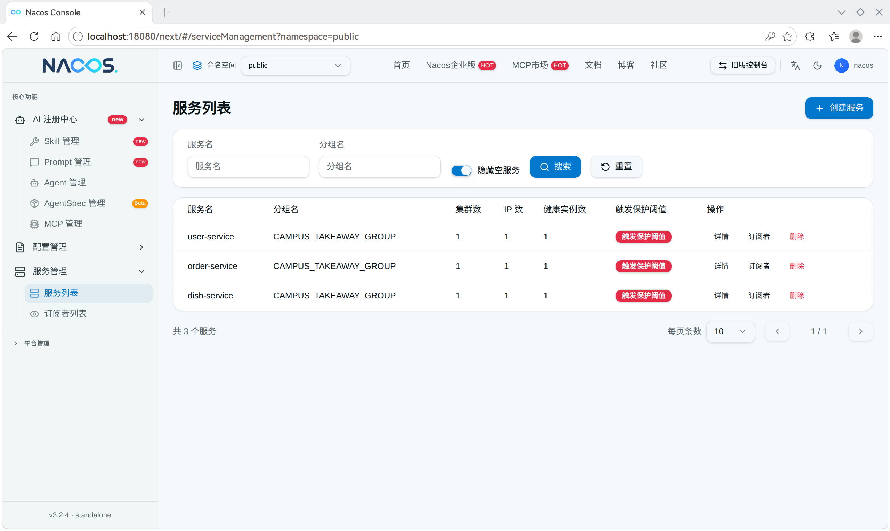


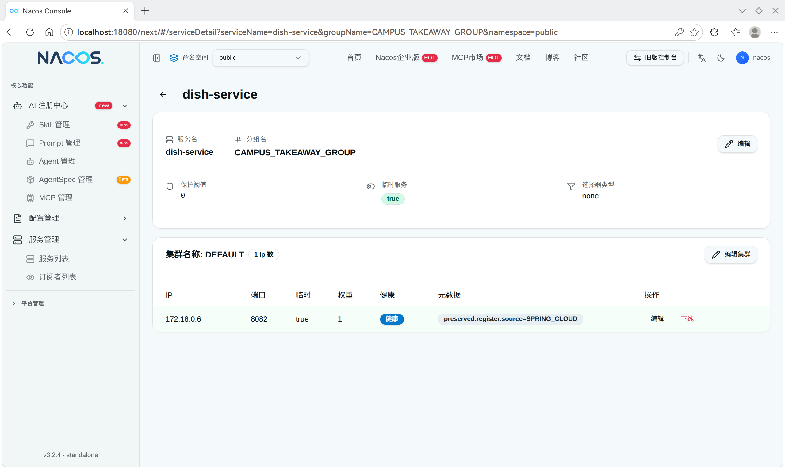

## 2. 配置隔离并完成服务发现调用

### 命名空间、分组与环境变量隔离

本次只使用默认命名空间 `public`（`.env` 中 `NACOS_NAMESPACE` 留空），三个服务所在分组统一为 `CAMPUS_TAKEAWAY_GROUP`。分组替代课堂示例的 `COURSE_GROUP`，不与其他课程示例或他人环境混用；服务名、分组、命名空间三者共同决定一次服务发现的查询范围，注册与订阅必须一致。若需要隔离开发、测试与生产，先在控制台创建命名空间，再把实际 Namespace ID 填入 `NACOS_NAMESPACE`，三处同时生效；分组保持不变。

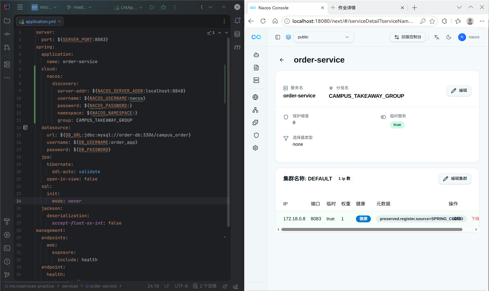

### 调用方向与实现

本次选择“创建订单”这条跨服务业务流程：订单服务先校验用户存在且可下单，再预校验菜品，最后按操作号扣减库存并保存订单。调用关系为 `order-service` → `user-service`、`order-service` → `dish-service`，用户与菜品服务不回调订单服务。

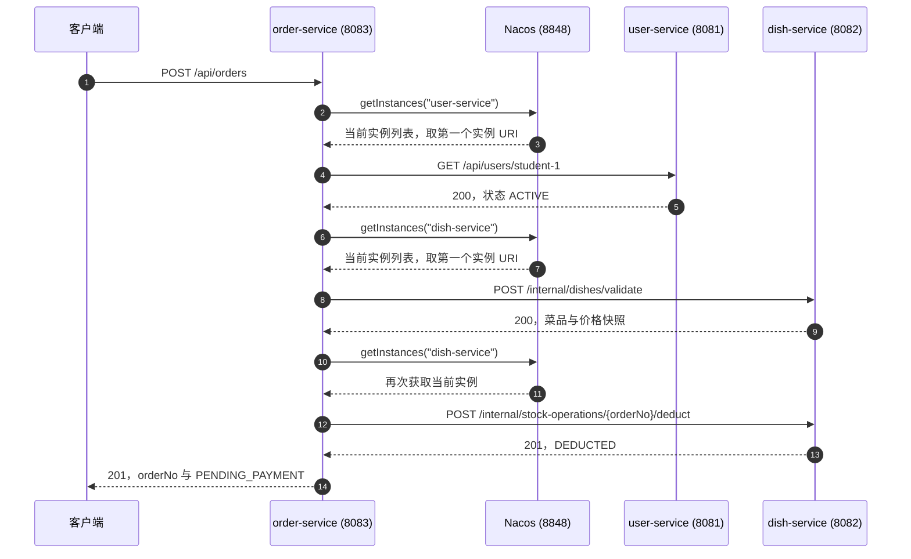

[ServiceLocator](../../../services/order-service/src/main/java/com/zjgsu/lht/client/ServiceLocator.java) 封装寻址，每次调用都重新查询实例，不缓存启动时的地址：

```java
public String baseUrl(String serviceName) {
    try {
        var instances = discovery.getInstances(serviceName);
        if (instances.isEmpty()) {
            throw new ResourceAccessException("服务暂无可用实例: " + serviceName);
        }
        return instances.getFirst().getUri().toString();
    } catch (ResourceAccessException ex) {
        throw ex;
    } catch (RuntimeException ex) {
        throw new ResourceAccessException("服务发现失败: " + serviceName, new IOException(ex));
    }
}
```

[UserClient](../../../services/order-service/src/main/java/com/zjgsu/lht/client/UserClient.java) 与 [DishClient](../../../services/order-service/src/main/java/com/zjgsu/lht/client/DishClient.java) 用 `services.baseUrl("服务名") + 原业务路径` 组成请求地址，再交给 `RestTemplate`：

| 客户端 | 取址方式 | 实际请求 |
|---|---|---|
| `UserClient.requireActive` | `services.baseUrl("user-service")` | `GET {实例URI}/api/users/{id}` |
| `DishClient.validate` | `services.baseUrl("dish-service")` | `POST {实例URI}/internal/dishes/validate` |
| `DishClient.deduct` | `services.baseUrl("dish-service")` | `POST {实例URI}/internal/stock-operations/{orderNo}/deduct` |
| `DishClient.release` | `services.baseUrl("dish-service")` | `PUT {实例URI}/internal/stock-operations/{orderNo}/release` |

一次成功的下单会调用 `getInstances` 三次（用户 1 次、菜品 2 次），因此预校验与扣减即使落到不同实例，也使用各自最新发现的地址，而不是启动时保存的地址。本周只取列表中的第一个实例，不实现轮询、权重路由、自动重试或熔断。

[HttpClientConfiguration](../../../services/order-service/src/main/java/com/zjgsu/lht/client/HttpClientConfiguration.java) 保留连接超时 2 秒、读取超时 5 秒（`HTTP_CONNECT_TIMEOUT`、`HTTP_READ_TIMEOUT` 可覆盖），分别设置到 JDK `HttpClient` 与 `JdkClientHttpRequestFactory`，未因改用服务发现而放宽或取消超时。

[DependencyCalls](../../../services/order-service/src/main/java/com/zjgsu/lht/client/DependencyCalls.java) 统一翻译寻址与调用异常：

| 情况 | 返回 |
|---|---|
| 实例列表为空、Nacos 查询异常（非超时）、连接被拒绝 | 503 `DEPENDENCY_UNAVAILABLE` |
| 连接或读取超时（含带超时原因的寻址异常） | 504 `DEPENDENCY_TIMEOUT` |
| 下游返回业务 404/409（如 `USER_NOT_FOUND`、`DISH_NOT_FOUND`） | 原状态码与原业务码，不跳过校验 |
| 下游响应结构不合法、非预期 5xx 或 `202` | 502 `DEPENDENCY_BAD_RESPONSE` |

列表为空时不会退化成 Compose 服务名或固定地址，也不会放行下单；依赖资源不存在时保留原有 404，与“依赖不可用”区分。

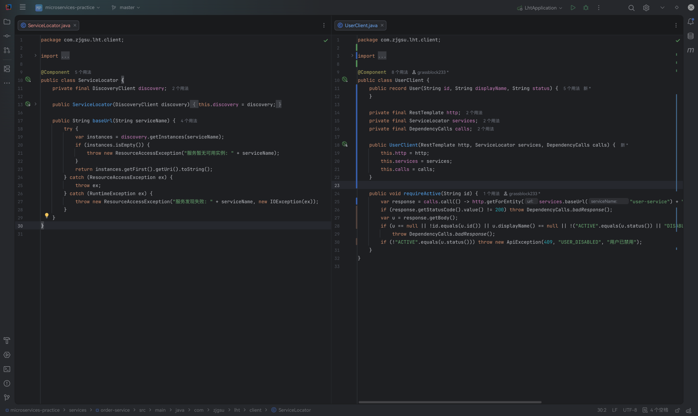

控制台显示的被调用实例 `user-service` 为 `172.18.0.7:8081`，`DiscoveryClient.getInstances("user-service")` 返回的实例 URI 由该 IP 与端口组成。按 `UserClient` 的代码，它会用该实例 URI 拼接业务路径，向 `http://172.18.0.7:8081/api/users/student-1` 发起用户查询；后文下单返回 201，说明这次经发现地址的调用成功。菜品调用使用同一机制，`dish-service` 的实例详情见第 1 节（`172.18.0.6:8082`）。两者都不是 `user-service:8081`、`dish-service:8082` 这类 Compose DNS 固定地址。


### 删除固定地址配置

第 06 周在订单服务中保存了 `clients.user.base-url` 与 `clients.dish.base-url`。本周已删除这两个配置项及对应的 `USER_SERVICE_URL`、`DISH_SERVICE_URL` 环境变量支持：

| 位置 | 第 06 周 | 本周 |
|---|---|---|
| `ClientProperties` | `Endpoint user`、`Endpoint dish`（各含 `baseUrl`） | 仅保留 `connectTimeout`、`readTimeout` |
| `application.yml` | `clients.user.base-url`、`clients.dish.base-url` | 仅保留 `clients.connect-timeout`、`clients.read-timeout` |
| 调用处 | 读取固定 `baseUrl` | 每次 `ServiceLocator` 发现实例 |

`services/` 与 `compose.yaml` 中已不存在 `USER_SERVICE_URL`、`DISH_SERVICE_URL` 或写死的 `http://user-service:8081`、`http://dish-service:8082`；保留下来的只有注册中心地址、账号凭据、数据库连接和 HTTP 超时配置。第 06 周文档中的相应描述作为历史记录保留。

### 空实例处理与测试

订单测试用 `@MockitoBean DiscoveryClient` 模拟寻址、用 `MockRestServiceServer` 模拟远程响应，不连接真实 Nacos 或 MySQL。与空实例、地址刷新相关的用例如下：

| 测试方法 | 验证内容 |
|---|---|
| `noUserInstancesReturns503AndRecoveryAllowsANewOrder` | 用户实例为空时返回 503 与 `DEPENDENCY_UNAVAILABLE`，不写入下单记录，且不再调用菜品服务；恢复实例列表后同一流程可成功下单 |
| `noDishInstancesNeverCreatesOrderOrAttempt` | 菜品实例为空时返回 503，订单、明细、下单记录均为 0 |
| `discoveryFailureReturns503BeforeAnyWrite` | `getInstances` 抛异常时同样在写库前返回 503 |
| `deductionUsesUpdatedInstanceAfterPrevalidation` | 预校验后菜品实例列表变化，扣减请求发往新地址；`getInstances("dish-service")` 被调用两次 |
| `unavailableUserNeverFallsBack` / `prevalidationTimeoutCreatesNoAttempt` | 连接失败返回 503、超时返回 504，均不降级放行 |

测试中的实例地址使用 `192.0.2.11:9081`、`192.0.2.12:9082` 等预留文档地址，故意与 Compose 服务名和实际端口不同，确保请求确实来自发现结果；`application-test.yml` 关闭 `spring.cloud.discovery` 与 Nacos 自动注册，测试不依赖真实注册中心。

### 请求示例与实际结果

```http
POST http://localhost:8083/api/orders
Content-Type: application/json

{
  "userId": "student-1",
  "merchantId": 10,
  "items": [{"dishId": 1, "quantity": 1}],
  "deliveryAddress": "test",
  "remark": ""
}
```

预期结果是：实例列表非空时，订单服务用发现到的实例地址完成用户校验、菜品预校验和库存扣减，返回 201、新订单号与待支付状态。本次实际返回 `HTTP/1.1 201`，`Location: http://localhost:8083/api/orders/1c85d1b3-4f6b-4e1c-8acd-52422275c56e`，响应体：

```json
{"orderNo":"1c85d1b3-4f6b-4e1c-8acd-52422275c56e","totalAmount":12.50,"status":"PENDING_PAYMENT"}
```

金额 12.50 来自菜品服务返回的权威价格快照，说明订单服务确实通过发现到的用户、菜品实例完成了校验与扣减，而不是访问固定地址。随后 `GET /api/orders?userId=student-1` 中新增该订单，创建时间为 `2026-11-08T06:11:49.743046`（UTC），本地业务数据发生变化。

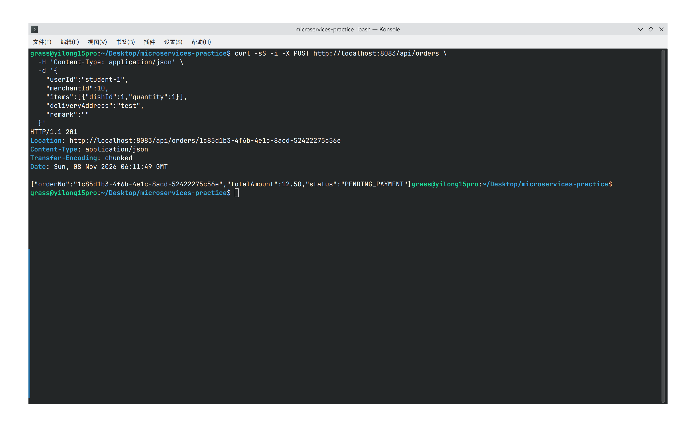

## 3. 健康状态、下线与恢复

### 应用健康接口

三个服务均保留 Actuator 健康端点，只检查本服务与自己的数据库，不递归调用其他业务服务，也不把注册中心状态当作业务健康：

```bash
for port in 8081 8082 8083; do
  curl -sS -i "http://localhost:$port/actuator/health"
done
```

本次三个端点均返回 `HTTP/1.1 200`，响应体为 `{"groups":["liveness","readiness"],"status":"UP"}`。

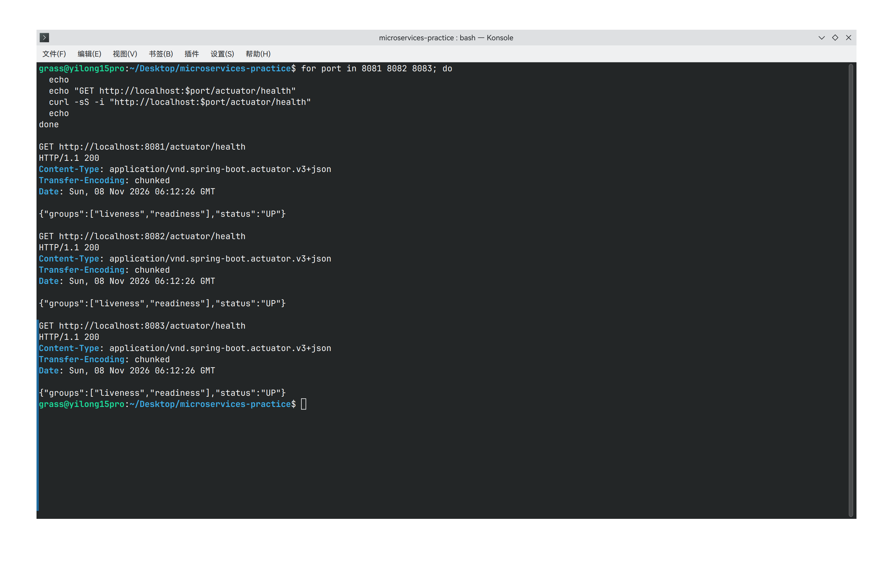

### 停止依赖服务与失败结果

```bash
sudo docker compose stop user-service
curl -fsS 'http://localhost:8083/api/orders?userId=student-1'   # 失败前订单列表
curl -sS -i -X POST http://localhost:8083/api/orders \
  -H 'Content-Type: application/json' \
  -d '{"userId":"student-1","merchantId":10,"items":[{"dishId":1,"quantity":1}],"deliveryAddress":"test","remark":""}'
```

`user-service` 容器停止后，其 SDK gRPC 连接断开，临时实例被 Nacos 清理；控制台服务列表由 3 个服务变为 2 个，只剩 `order-service` 与 `dish-service`，分组仍为 `CAMPUS_TAKEAWAY_GROUP`。

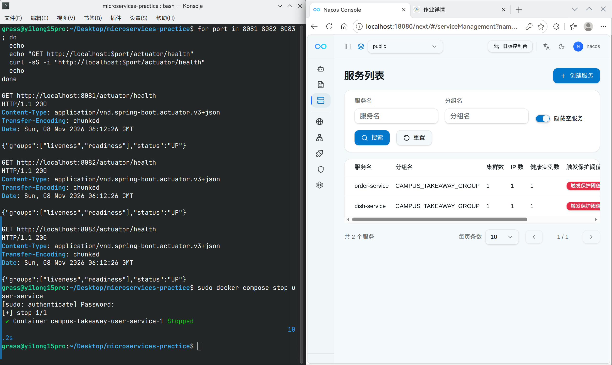

随后用同一组有效业务参数重新提交一次下单请求（若成功，服务端会生成新的订单号），返回 `HTTP/1.1 503`，问题响应体为：

```json
{"detail":"依赖服务无法连接","instance":"/api/orders","status":503,"title":"Service Unavailable","code":"DEPENDENCY_UNAVAILABLE"}
```

失败发生在第一步用户校验：`DiscoveryClient` 已无 `user-service` 实例（或仍缓存旧地址但连接失败），`ServiceLocator` 抛出寻址异常，`DependencyCalls` 统一映射为 503，未继续调用菜品服务。请求参数本身有效（与上一次成功下单相同），失败只由依赖不可用引起，与参数内容无关。因此本次失败没有新增业务订单，也没有生成 `order_attempts` 下单记录；失败前后两次订单列表查询内容相同，仍包含失败前已创建的 `1c85d1b3-4f6b-4e1c-8acd-52422275c56e`，依赖校验失败没有绕过规则写入本地数据。

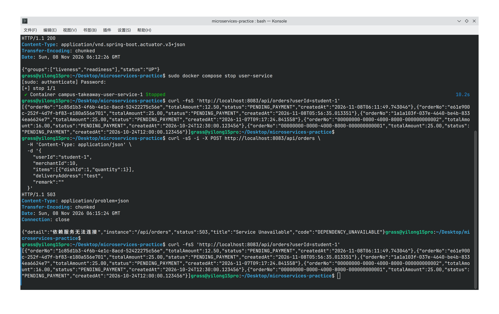

### 恢复服务与再次验证

```bash
sudo docker compose up -d --wait user-service
curl -sS -i http://localhost:8081/actuator/health
```

`up -d --wait` 输出 3 个容器 Healthy（`nacos`、`user-db`、`user-service`），`user-service` 重新注册为临时实例。等待业务接口可访问后，用同样参数再次提交订单，返回 `HTTP/1.1 201`，订单号为 `2a8f9155-ee2b-4367-8c4d-1108179288ac`，金额 12.50，状态 `PENDING_PAYMENT`；`GET http://localhost:8081/actuator/health` 恢复 `200` 与 `status=UP`。

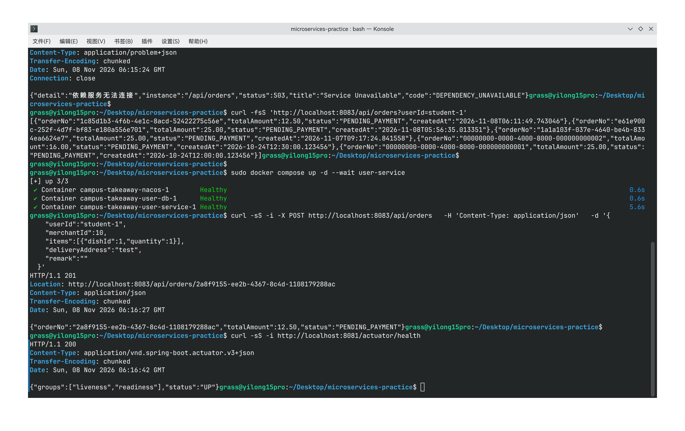

### SDK 连接、注册实例与 Actuator 健康的区别

| 层次 | 含义 | 本次系统中的表现 |
|---|---|---|
| SDK gRPC 连接（`9848`） | 应用与 Nacos 服务端之间的长连接，用于注册、心跳与订阅推送 | 连接断开或心跳超时后，Nacos 认为提供者已离线 |
| 注册实例状态 | 服务端记录的实例是否存在、是否为临时实例、是否健康 | `user-service` 停止后实例被清理，列表不再显示 |
| Actuator 应用健康 | 应用自身（本服务 + 自己的数据库）的运行状态 | 三个服务正常时均为 `UP`；只反映本服务，不探测其他服务 |

三者不能互相替代：

- 注册连接存活只说明应用还在与 Nacos 通信，不代表业务正常。若数据库故障使 `/actuator/health` 返回 `DOWN`，而 gRPC 连接仍然正常，Nacos 默认不会轮询 Actuator，也不会因此自动摘除实例；消费者仍可能发现并调用该实例。因此不能假设“Actuator DOWN 就会自动下线”，也不能把注册列表中的“健康”当作业务健康。
- 反过来，进程被停止时 gRPC 连接断开，临时实例被清理，即使没有触发 Actuator 的 `DOWN` 判定，消费者也会发现实例消失。
- 注册中心暂时不可用时，消费者可能继续使用缓存的实例，但新实例注册和列表变化感知会受影响；缓存不保证业务永远可用，也不能替代对空实例、连接失败和超时的显式处理。

本次停止的是整个 `user-service` 容器，连接断开与业务不可用同时发生，因此表现为“实例消失 + 请求 503”。这不能证明“数据库单独故障时实例会被自动摘除”。

## 4. 验证脚本、测试与结论

### 冒烟脚本检查项

[scripts/smoke-test.sh](../../../scripts/smoke-test.sh) 从仓库根目录执行，依赖 `curl` 与 `python3`，`set -euo pipefail`，任一 HTTP 状态码或数据断言不符合预期即非零退出：

```bash
bash scripts/smoke-test.sh
```

| 检查项 | 断言 |
|---|---|
| Nacos 控制台 | `GET http://localhost:18080/` 为 200，使用新控制台地址，不用旧版 `8848/nacos` |
| 三个服务健康 | `/actuator/health` 均为 200，且 `status=UP` |
| 用户与菜品查询 | `GET /api/users/student-1`、`GET /api/dishes?merchantId=10` 均为 200，用户为 `ACTIVE`、测试菜品库存至少 2 |
| 下单 | `POST /api/orders` 为 201，订单号为 UUID |
| 订单与库存 | 订单详情状态 `PENDING_PAYMENT`，明细合并、金额等于单价快照、库存减少 2、库存操作为 `DEDUCTED`、订单列表增加 1 |
| 异常场景 | 用户不存在 404、用户禁用 409、菜品不存在 404，错误码分别为 `USER_NOT_FOUND`、`USER_DISABLED`、`DISH_NOT_FOUND` |
| 拒绝后数据 | 三次失败后订单列表与菜品库存与失败前完全一致 |

本次运行结果：

```text
PASS orderNo=a67abd28-8ea3-4b62-9b3b-9a8e71c975cc amount=25.00 stock=10->8
PASS rejected USER_NOT_FOUND
PASS rejected USER_DISABLED
PASS rejected DISH_NOT_FOUND
PASS rejected requests left orders and inventory unchanged
All smoke checks passed. Keep orderNo=a67abd28-8ea3-4b62-9b3b-9a8e71c975cc for persistence verification.
```

脚本正常结束时退出码为 `0`。为验证失败路径，把控制台地址覆盖为不存在的端口再次执行：

```bash
NACOS_CONSOLE_URL=http://127.0.0.1:11111/ bash scripts/smoke-test.sh
```

`curl` 连接失败返回 `(7)`，脚本以退出码 `7` 结束，没有把错误忽略后报告成功。

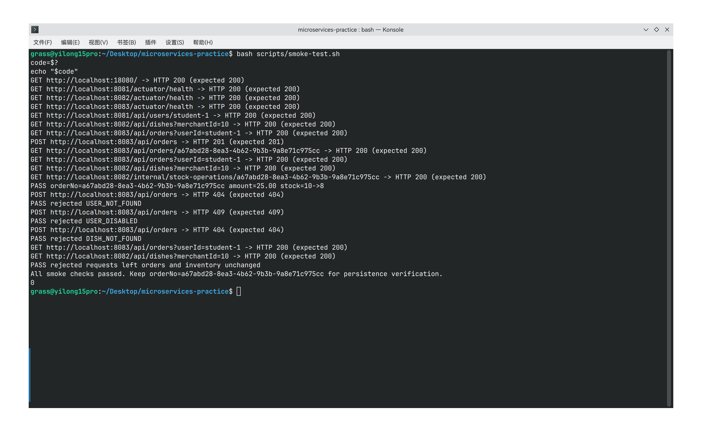

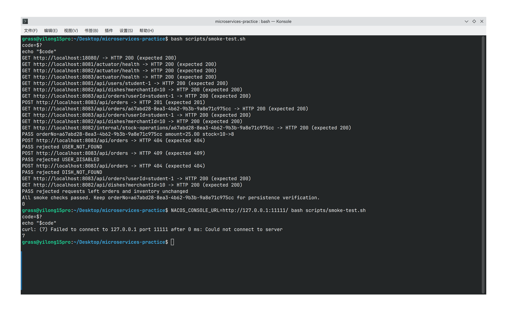

### 各服务测试命令与结果

测试不依赖真实 Nacos 或 MySQL，进入对应工程或从根目录执行（需 JDK 25 与 Maven 3.9+，安装要求见 [README](../../../README.md#独立工程测试)）：

```bash
(cd services/user-service && mvn test)
(cd services/dish-service && mvn test)
(cd services/order-service && mvn test)
```

| 工程 | 测试数 | 失败 / 错误 / 跳过 | 测试耗时 | 结果 |
|---|---|---|---|---|
| `user-service` | 4 | 0 / 0 / 0 | 4.537 s | BUILD SUCCESS |
| `dish-service` | 14 | 0 / 0 / 0 | 5.060 s | BUILD SUCCESS |
| `order-service` | 25 | 0 / 0 / 0 | 5.903 s | BUILD SUCCESS |
| 合计 | **43** | **0 / 0 / 0** | — | 三个工程均通过 |

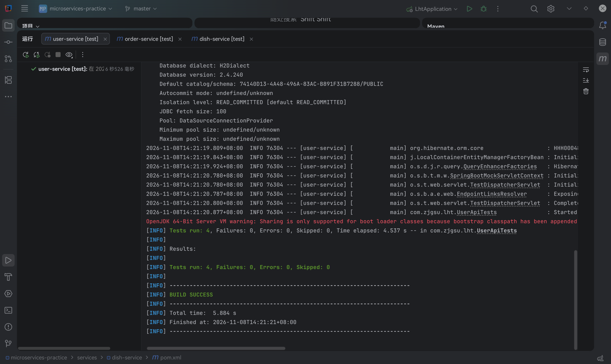

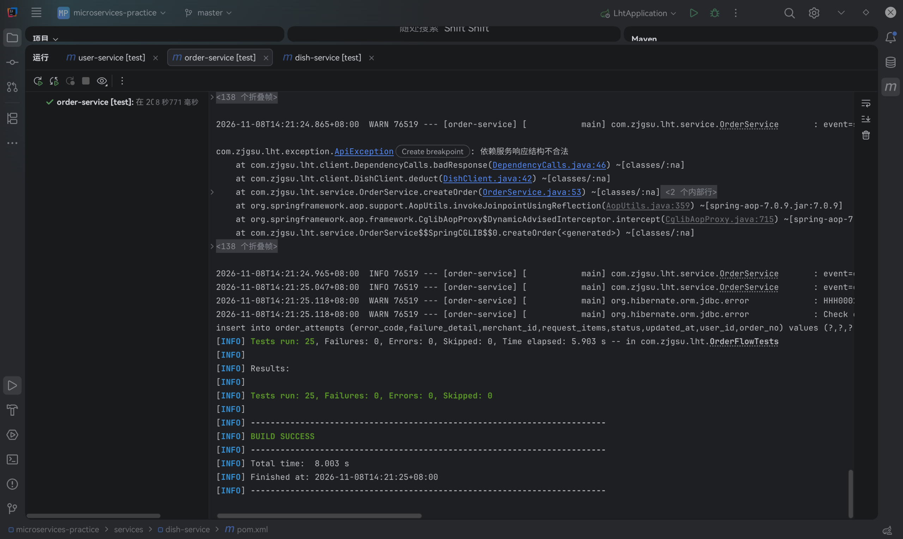

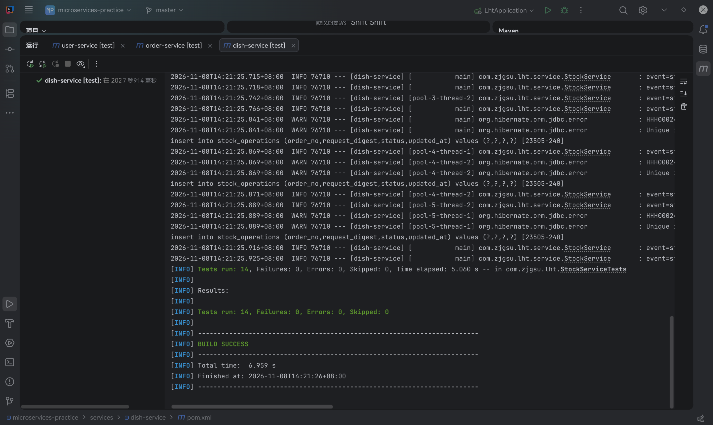

测试边界明确：使用 `test` Profile 的 H2 内存数据库，关闭 `spring.cloud.discovery.enabled` 与 `spring.cloud.service-registry.auto-registration.enabled`，订单测试模拟 `DiscoveryClient` 与远程 HTTP 响应，不注册到真实 Nacos、不连接 MySQL；Compose 冒烟另行验证真实容器间的注册与调用。README 中已写明启动、查看服务列表、运行冒烟和进入各服务执行测试的命令。

### 整体结论

- Nacos 3.2.4 以 standalone + 鉴权方式编排在根 `compose.yaml`，使用命名卷持久化，控制台 `18080`、服务端 `8848`、SDK `9848` 三个入口职责清晰，密钥仅存于本地 `.env`。
- 三个服务以不同 `spring.application.name` 注册到默认命名空间的 `CAMPUS_TAKEAWAY_GROUP`，实例地址与端口可在控制台核对；依赖由课程 BOM 统一管理。
- 下单流程已从固定地址改为 `DiscoveryClient` 动态寻址，使用实例 URI 完成真实 HTTP 调用；空实例返回 503，业务 404 保留，超时与异常响应分别映射为 504 与 502。
- 正常、下线、恢复三种状态均有请求结果、状态码、控制台列表和订单数据核对；脚本成功与失败路径分别以退出码 0 和 7 证明检查有效。
- 本周只选择第一个实例，未实现负载均衡、自动重试、熔断和跨服务事务；服务发现不消除“远端扣减成功、本地订单保存失败”的事务窗口，补偿与人工核对沿用第 06 周方案。
