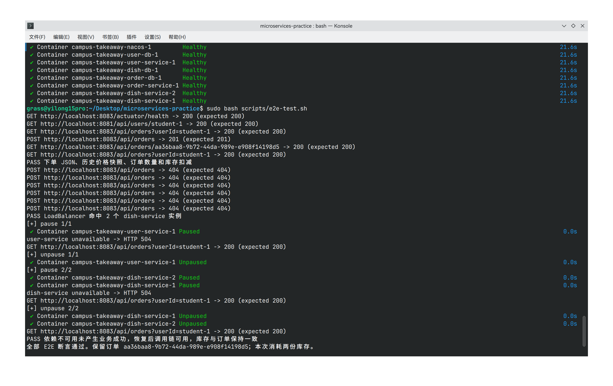
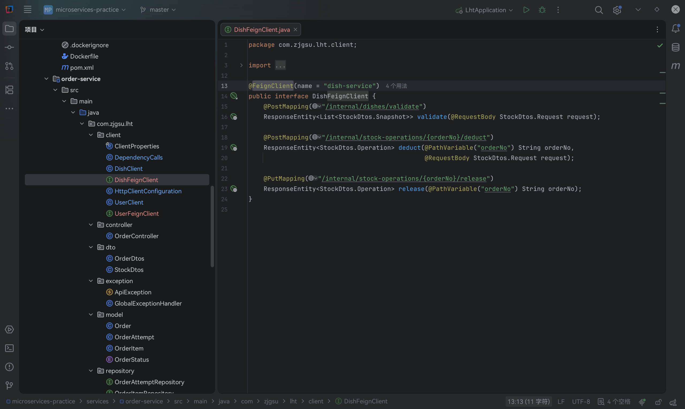
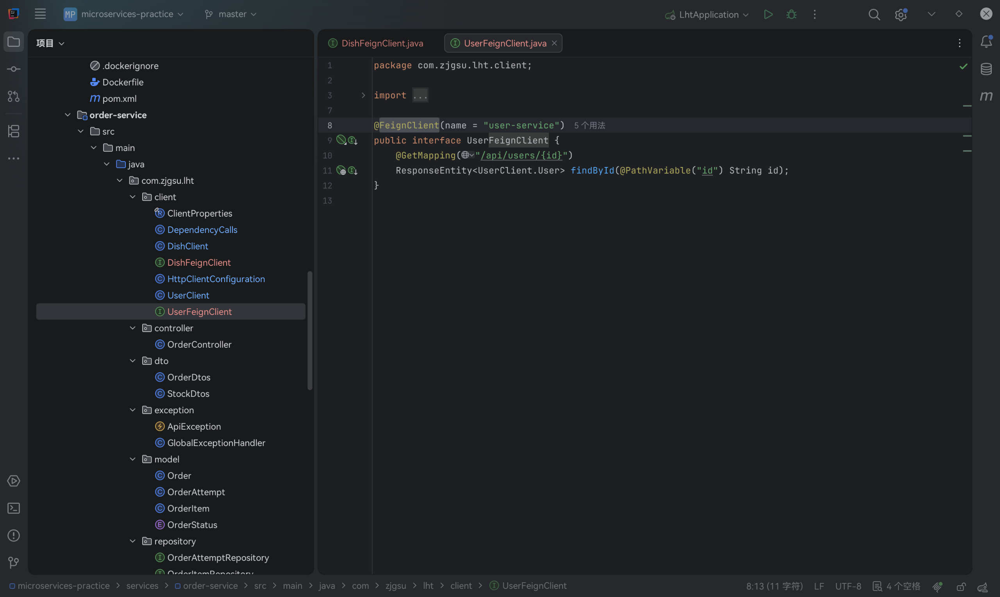
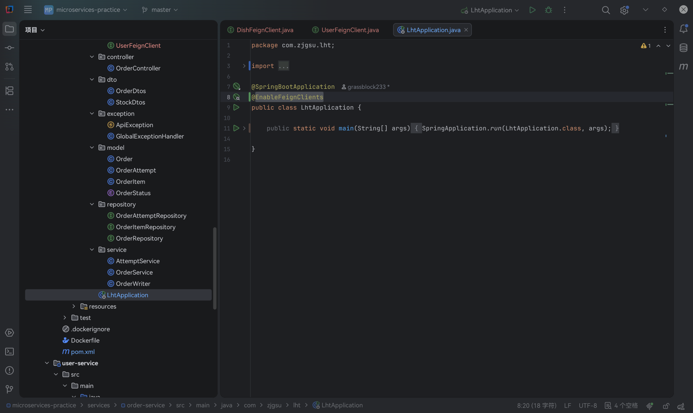
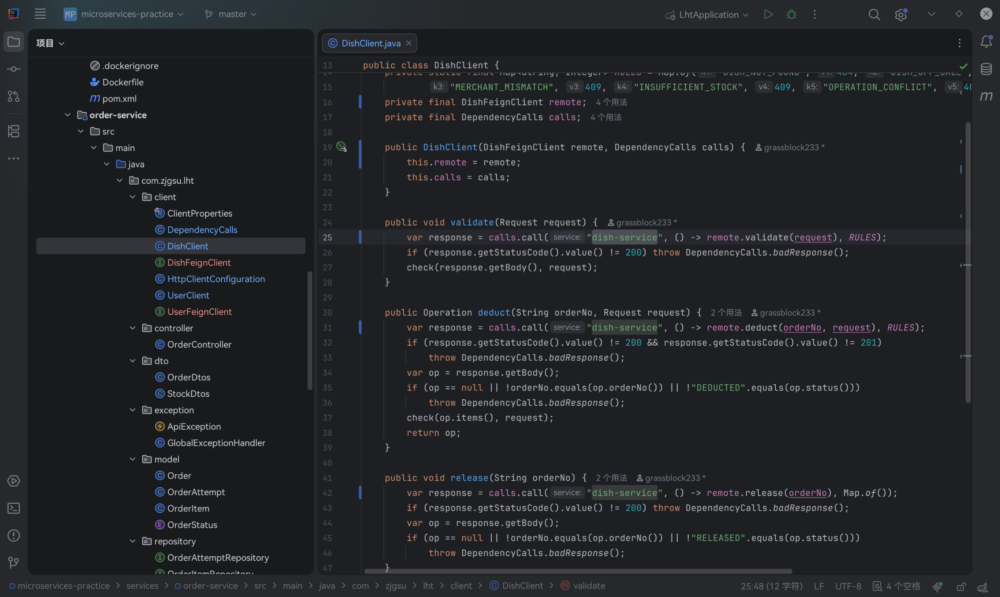
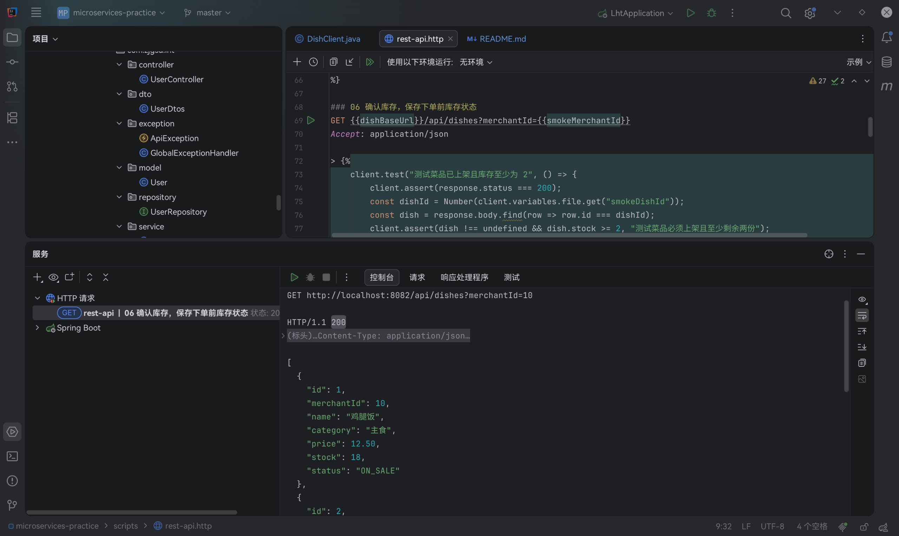
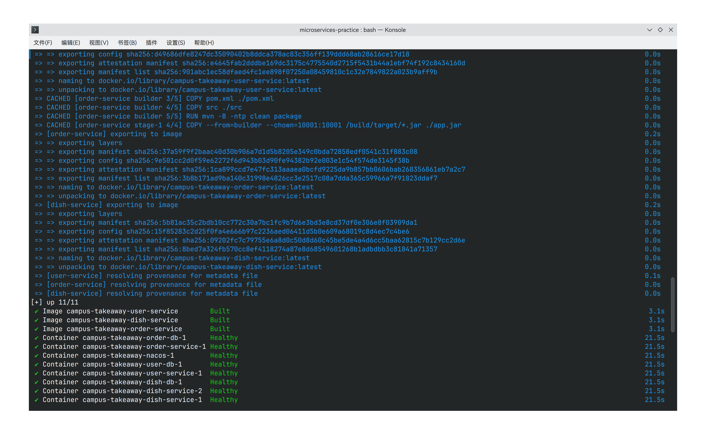
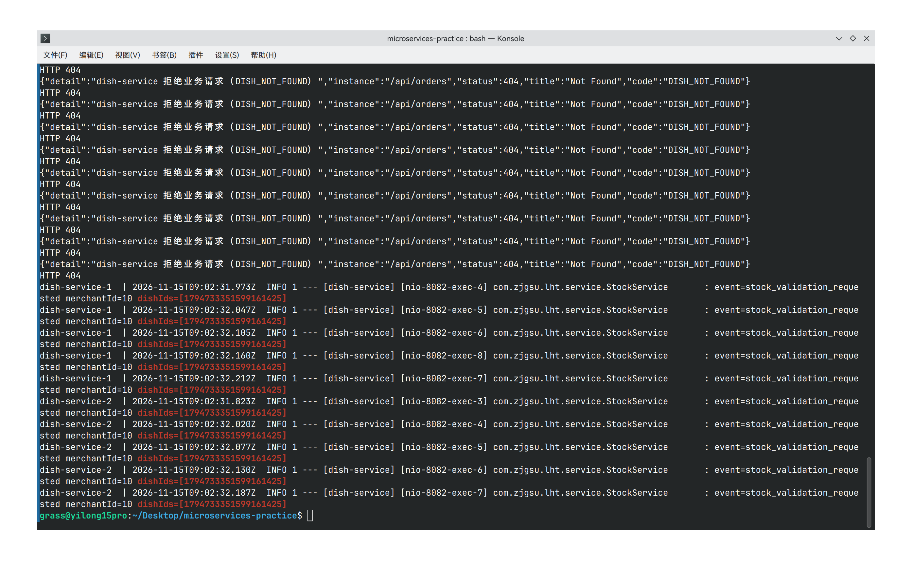
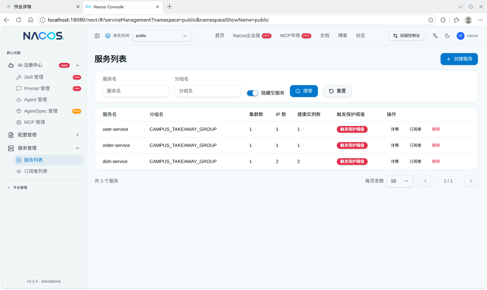
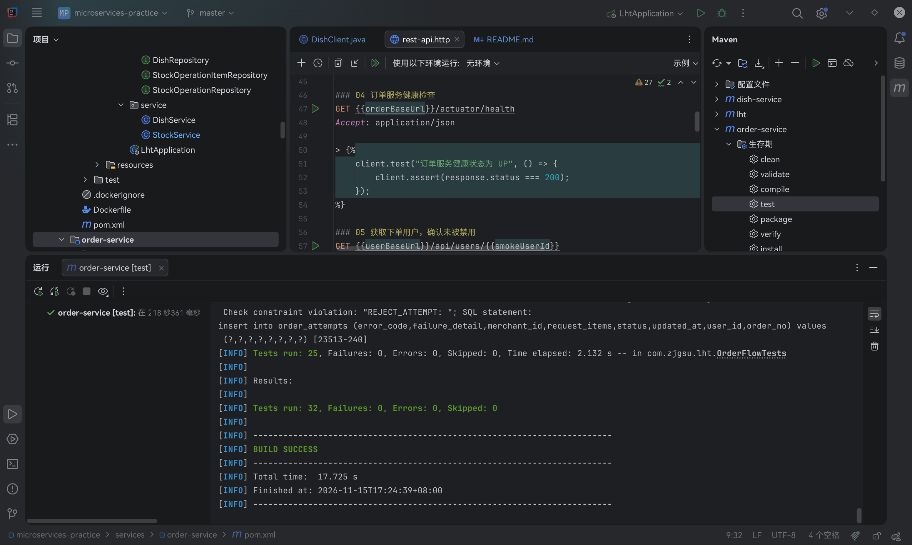

# 第 08 周：服务通信与负载均衡

本周在校园外卖微服务项目中实现 OpenFeign 同步调用，并验证多实例负载均衡及依赖故障处理。本文结果依据 2026-11-15 已保存的运行截图记录；本次文档整理未重新构建、启动服务或执行测试。

## 一、选择一个跨服务业务流程

### 实现思路

选择“学生下单”作为跨服务流程，调用方为 `order-service`，被调用方为 `user-service` 和 `dish-service`。三个工程位于仓库根目录的 `services/<服务名>/`，各自使用独立数据库。当前流程止于创建待支付订单，不包含支付和配送。

| 步骤 | 调用方 → 被调用方 | 接口与职责 |
| --- | --- | --- |
| 1 | 客户端 → order-service | `POST /api/orders`：接收用户、商家、菜品数量和配送地址，合并重复菜品 |
| 2 | order-service → user-service | `GET /api/users/{id}`：查询用户，订单侧校验用户为 `ACTIVE` |
| 3 | order-service → dish-service | `POST /internal/dishes/validate`：预校验商家、菜品上架状态和库存，不扣库存 |
| 4 | order-service → dish-service | `POST /internal/stock-operations/{orderNo}/deduct`：按订单号幂等扣减库存，返回扣减时的价格快照 |
| 5 | order-service → 订单数据库 | 保存订单和明细，返回 `201 Created` 与 JSON，状态为 `PENDING_PAYMENT` |

调用链路及事务边界见 [服务间通信设计](../../service-communication.md)。预校验与扣减可能命中不同菜品实例，库存通过共享的菜品数据库、唯一操作号和行锁协调。订单金额使用扣减成功时的价格快照，避免客户端报价或预校验之后价格变化造成不一致。

库存扣减、订单保存分别使用本地事务；扣减结果未知或保存失败时，按同一订单号尝试补偿。补偿失败或无法确认订单提交结果时，记录 `RECOVERY_REQUIRED`，交由人工核对。

### 运行命令

以下命令均从仓库根目录执行。首次环境准备、`.env` 配置及 Nacos 管理员初始化按 [README](../../../README.md) 完成；需要 Docker Compose、Docker 权限、`curl` 和 `python3`。多实例配置使用根目录 `compose.yaml` 叠加 `compose.scale.yaml`。

```bash
sudo docker compose -f compose.yaml -f compose.scale.yaml up -d --build --scale dish-service=2 --wait
sudo docker compose -f compose.yaml -f compose.scale.yaml ps
curl -fsS http://localhost:8083/actuator/health
curl -fsS http://localhost:8081/api/users/student-1
sudo docker compose -f compose.yaml -f compose.scale.yaml exec -T --index 1 dish-service \
  curl -fsS "http://localhost:8082/api/dishes?merchantId=10"
sudo bash scripts/e2e-test.sh
```

E2E 使用用户 `student-1`、商家 `10`、菜品 `1`，可通过脚本环境变量覆盖。运行前需确认用户有效、菜品上架且至少剩余两份库存；脚本会创建并保留一个真实订单、消耗两份库存，并短暂暂停后恢复依赖服务。重复运行需保证库存充足，验证期间避免并发修改数据。

### 运行结果

已有 E2E 截图显示，`POST /api/orders` 返回预期的 201，订单详情及列表查询返回 200；脚本完成 JSON 解析、重复菜品合并、订单金额与历史价格快照、订单数量增加及库存扣减两份的断言。该次保留订单号为 `aa36aba8-9b72-44da-989e-e908f14198d5`。



## 二、使用 OpenFeign

### 实现思路

订单工程在 `pom.xml` 中引入 OpenFeign、Spring Cloud LoadBalancer 和 Nacos 服务发现依赖，启动类通过 `@EnableFeignClients` 启用客户端扫描。

- `UserFeignClient` 使用 `@FeignClient(name = "user-service")` 查询用户。
- `DishFeignClient` 使用 `@FeignClient(name = "dish-service")` 执行菜品预校验、库存扣减和库存释放。
- 通过服务名发现目标实例，没有写死容器 IP；各服务使用相同的 Nacos namespace 和 `CAMPUS_TAKEAWAY_GROUP`。
- `UserClient`、`DishClient` 校验 HTTP 状态和响应内容；`DependencyCalls` 统一映射业务拒绝、连接失败、超时及异常响应；全局异常处理返回带 `status`、`code`、`detail` 的 JSON 错误。
- 默认连接超时为 2 秒、读取超时为 5 秒，Feign 和 LoadBalancer 自动重试关闭。

业务拒绝保留明确的业务错误码，例如 `DISH_NOT_FOUND` 对应 404、库存不足对应 409；依赖不可用返回 503，超时返回 504，无法接受的响应返回 502。调用失败不会通过返回伪造的用户、库存或订单成功结果来降级。

### 运行命令

完成第一部分的多实例启动后，从仓库根目录执行：

```bash
mvn -f services/order-service/pom.xml test
sudo bash scripts/e2e-test.sh
```

Java 测试需要 JDK 25 和 Maven。`FeignClientTests` 通过本机随机端口 HTTP 服务验证真实 Feign 调用，并模拟服务发现；E2E 在真实 Compose 服务之间验证同步调用及依赖不可用场景。

### 运行结果与截图

代码截图显示客户端按服务名声明、启动类启用 Feign，以及 `DishClient` 对返回状态和库存操作内容的检查。订单服务测试及真实服务 E2E 的通过结果见第四部分。下列菜品查询截图仅作为响应格式及数据准备证据，跨服务下单成功以 E2E 截图为准。











## 三、负载均衡验证

### 实现思路

根目录 `compose.yaml` 定义菜品服务及其数据库，`compose.scale.yaml` 通过 `ports: !reset []` 取消菜品服务固定宿主机端口映射，再以 `--scale dish-service=2` 启动两个实例，避免两个容器争用同一个宿主机端口。Compose 需支持该覆盖语法。

验证请求统一发送到订单服务，由订单服务经 Feign 和 LoadBalancer 访问菜品实例。使用本次生成的不存在菜品编号，触发不扣库存的预校验请求，并用该编号关联两个容器的业务日志。Nacos 注册列表只证明实例已注册，实际分发以请求日志为准。

### 运行命令

在仓库根目录、同一个 Bash 终端执行：

```bash
sudo docker compose -f compose.yaml -f compose.scale.yaml config --quiet
sudo docker compose -f compose.yaml -f compose.scale.yaml up -d --build --scale dish-service=2 --wait
sudo docker compose -f compose.yaml -f compose.scale.yaml ps

LB_DISH_ID=$(python3 -c 'import time; print(time.time_ns())')
printf '本次验证菜品编号：%s\n' "$LB_DISH_ID"
for i in {1..10}; do
  curl -sS --connect-timeout 3 --max-time 15 -w '\nHTTP %{http_code}\n' \
    http://localhost:8083/api/orders -H 'Content-Type: application/json' \
    -d "{\"userId\":\"student-1\",\"merchantId\":10,\"items\":[{\"dishId\":$LB_DISH_ID,\"quantity\":1}],\"deliveryAddress\":\"负载均衡验证\"}"
done
sudo docker compose -f compose.yaml -f compose.scale.yaml logs --no-color dish-service \
  | grep 'event=stock_validation_requested' | grep -F "dishIds=[$LB_DISH_ID]"
```

### 运行结果

已有截图显示两个 `dish-service` 容器均健康，Nacos 中菜品服务有两个健康实例。十次请求返回 404，JSON 错误码为 `DISH_NOT_FOUND`，符合使用不存在菜品编号的预期。编号 `179473351599161425` 的 `stock_validation_requested` 日志同时出现在 `dish-service-1` 和 `dish-service-2` 下，证明调用方实际访问了两个实例。不要求日志顺序严格交替。







## 四、测试

### 实现思路

测试分为 Java 测试与真实服务端到端验证：

| 测试 | 覆盖内容 |
| --- | --- |
| `FeignClientTests` | 真实 Feign HTTP、双实例轮询、业务错误、依赖故障、异常 JSON、远端写入后响应超时、补偿失败 |
| `OrderFlowTests` | 正常下单、合并菜品、价格快照、无可用实例、超时、订单事务回滚、补偿和提交结果核对 |
| `StockServiceTests` | 菜品服务库存操作逻辑，配合订单侧测试验证协作边界 |
| `scripts/e2e-test.sh` | 真实服务正常下单、JSON 与库存校验、双实例日志关联、依赖不可用与恢复后的数据一致性 |

E2E 分别暂停 `user-service` 和全部 `dish-service` 实例，断言响应为 503 或 504、错误体包含明确错误码和说明，且没有新增成功订单。恢复依赖后，通过不会扣库存的预校验请求确认调用链可用，最后对比订单与库存。故障注入位于校验阶段，写操作已经执行但响应超时的情况由 Java 测试单独覆盖。

**写操作超时后的结果可能未知。** 例如菜品服务可能已扣减库存，但响应未能及时到达订单服务；503/504 不能直接证明远端没有执行。因此关闭自动写重试，使用原 `orderNo` 核对订单与库存操作，按同一操作号补偿；补偿失败或提交结果无法确认时进入 `RECOVERY_REQUIRED` 人工核对。库存操作幂等不等于外部下单接口幂等，重复提交下单请求会生成新订单号。

### 运行命令

在仓库根目录执行 Java 测试：

```bash
mvn -f services/user-service/pom.xml test
mvn -f services/dish-service/pom.xml test
mvn -f services/order-service/pom.xml test
```

准备好第一部分的双实例环境，确认测试菜品至少剩余两份库存，再从仓库根目录执行：

```bash
sudo bash scripts/e2e-test.sh
```

脚本会自动定位仓库根目录、解析业务 JSON、断言状态与数据，并在正常结束或异常退出时尝试恢复本次暂停的服务。若提示自动恢复失败，按提示手动恢复对应服务后再进行下一次验证。

### 运行结果与截图

- 订单服务 Java 测试截图显示 `Tests run: 32, Failures: 0, Errors: 0, Skipped: 0`，并显示 `BUILD SUCCESS`。此截图证明订单工程的测试结果，不将其扩大为三个工程的测试总数。
- E2E 正常下单返回 201，订单查询返回 200，JSON、历史价格快照、订单数量和库存扣减断言通过。
- E2E 输出 `PASS LoadBalancer 命中 2 个 dish-service 实例`。
- 暂停用户服务、暂停两个菜品实例时，下单均返回 HTTP 504；脚本完成失败响应及订单未增加的断言。
- 依赖恢复后，调用链恢复可用，库存与订单对比断言通过，最终输出“全部 E2E 断言通过”。




