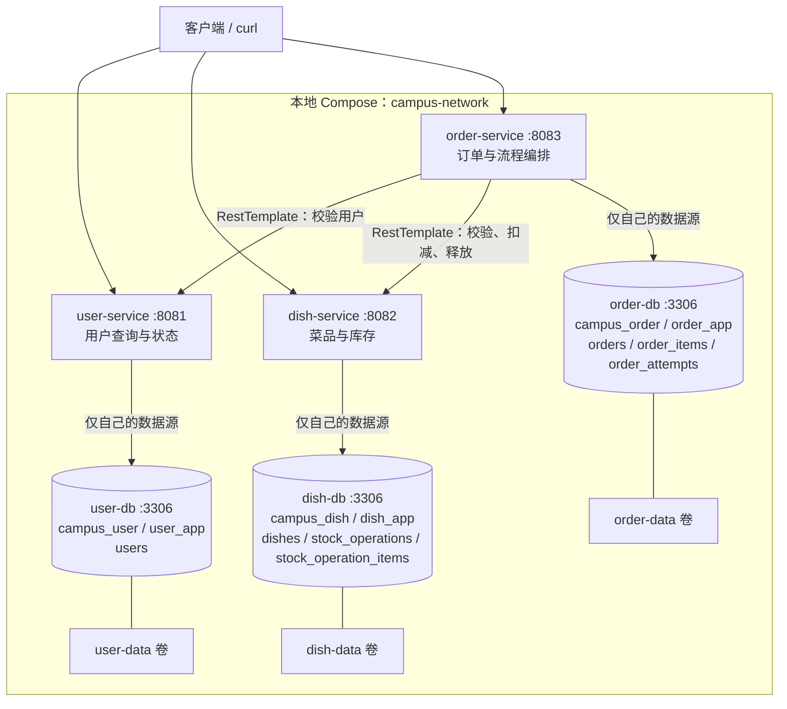

# 校园外卖平台微服务拆分设计

## 1. 本周范围

已确认的关键决策：

| 问题 | 决策 |
|---|---|
| 服务边界 | `user-service`、`dish-service`、`order-service` 三个服务 |
| 用户能力 | 新增最小用户表与查询，下单前校验用户存在且可用 |
| 数据库部署 | 三个独立 MySQL 容器，各有数据库、业务账号及命名数据卷 |
| 库存行为 | 保留下单扣库存；订单写入失败时同步补偿，补偿失败留痕并人工核对 |

本周实现顺序下单流程、同步 HTTP 通信、基本失败处理和本地容器编排。用户注册登录、权限认证、商家管理、支付、配送、消息队列、服务注册中心、网关及完整分布式事务框架留待后续。`userId` 仍由请求传入，存在性校验不等于身份认证。

## 2. 单体模块到微服务的映射

现有应用的基础包名为 `com.zjgsu.lht`，使用 Spring Boot 4.0.8、Java 25、Spring Data JPA 和 MySQL。三个新应用继续使用相同基础包名，通过独立工程和独立进程隔离。

| 现有单体模块或能力 | 目标服务 | 拆分方式 |
|---|---|---|
| `DishController`、`DishService`、`DishRepository`、`Dish`、`DishStatus`、`DishDtos` | `dish-service` | 迁移菜品查询；拥有菜品、售价、上架状态及库存，新增批量校验、批量扣减及释放接口 |
| `OrderController`、`OrderService`、`OrderRepository`、`OrderItemRepository`、订单模型和 DTO | `order-service` | 迁移订单创建与查询；删除对 `DishRepository` 的依赖，改用 HTTP 客户端 |
| 订单中的 `userId` 及项目规划的账户模块 | `user-service` | 单体没有用户实体及用户表；新增最小用户模型、查询和状态校验能力 |
| `LhtApplication`、异常处理、健康检查与配置 | 各服务分别提供 | 每个工程有独立启动类、配置和异常处理；不依赖单体 JAR 或扫描其他工程 |
| 单体库存扣减和订单写入的共同事务 | 菜品服务与订单服务各自的本地事务 | 以顺序 HTTP 调用和失败补偿衔接，不能继续依靠一个 `@Transactional` 跨库回滚 |

`monolith/` 完整保留，继续作为单体版本；其源码、数据库脚本和历史文档不被新服务覆盖。原 `scripts/init.sql`、`scripts/reset.sql` 仍属于单体数据库 `campus_takeaway`，新服务不能直接复用其中的跨模块建表方式。

## 3. 服务职责、端口和数据所有权

| 服务 | 职责 | 应用端口（宿主机／容器） | MySQL Compose 服务名 | 独立数据库 | 独立业务账号 | 拥有的数据表 |
|---|---|---|---|---|---|---|
| `user-service` | 用户资料查询、是否允许下单的状态判断 | `8081 / 8081` | `user-db` | `campus_user` | `user_app` | `users` |
| `dish-service` | 菜品查询、售价与可售校验、库存批量扣减和补偿 | `8082 / 8082` | `dish-db` | `campus_dish` | `dish_app` | `dishes`、`stock_operations`、`stock_operation_items` |
| `order-service` | 编排下单、计算金额、保存订单快照、查询订单和记录失败处理状态 | `8083 / 8083` | `order-db` | `campus_order` | `order_app` | `orders`、`order_items`、`order_attempts` |

每个服务提供 `GET /actuator/health`，通过 Actuator 和本服务数据库连接判断健康。健康检查不递归调用其他业务服务；下游不可用由业务请求明确返回错误。健康信息不暴露密码等配置。

### 3.1 用户数据

`users` 最小字段为 `id VARCHAR(64)`、`display_name`、`status`，其中 `id` 为主键，保留现有 `student-1`、`student-2` 字符串标识；状态为 `ACTIVE`、`DISABLED`。初始化有效用户及禁用用户，支持成功与失败演示。本周不保存密码，也不提供注册和登录。

### 3.2 菜品和库存数据

`dishes` 保留单体字段及约束：菜品 ID、`merchant_id`、名称、分类、单价、库存、上架状态。商家 ID 仍是外部业务标识，本周不新增商家表或商家调用。

`stock_operations` 以订单服务生成的 `order_no` 为唯一操作键，记录请求内容摘要、状态 `DEDUCTED / RELEASED` 和处理时间。`stock_operation_items` 保存该次操作的菜品 ID、数量以及扣减时的名称和单价快照。两表均只由菜品服务访问，用于避免同一操作重复扣减或重复回补，并支持失败后核对。

### 3.3 订单数据

`orders`、`order_items` 保留原有业务字段、金额精度和唯一约束。创建成功的订单状态仍为 `PENDING_PAYMENT`。名称、单价和配送地址是订单自己的历史快照，查询历史订单不依赖菜品或用户服务在线。

`order_attempts` 按唯一 `order_no` 保存本次下单的用户 ID、商家 ID、合并后的菜品与数量、处理状态、错误码、时间和必要的下游操作信息。状态至少包含 `PROCESSING`、`SUCCEEDED`、`FAILED`、`RECOVERY_REQUIRED`。它是故障处理记录，不是成功业务订单；仅在用户和菜品预校验均成功后创建，使用独立本地事务提交，避免随订单事务回滚而丢失。

### 3.4 数据访问规则

- 每个应用只配置自己的一个数据源，仅注入自己的 Repository；不共享 JPA 实体或 Repository 工程。
- `orders.user_id`、`orders.merchant_id`、`order_items.dish_id` 仅存 ID，不建立跨库外键，不做跨库 JOIN、视图或直连查询。
- 订单库可保留 `order_items.order_id → orders.id` 外键；移除新订单库中原有的 `order_items.dish_id → dishes.id` 外键。单体脚本保持原样。
- 菜品操作明细与操作主表可建立同库外键；任何库存查询或变更都由菜品服务 API 完成。
- 三个数据库业务账号分别仅授权自己的库；应用不使用 root，订单应用也不持有用户库或菜品库凭据。

## 4. 工程与文件布局

```text
仓库根目录/
├── monolith/                         # 保留现有单体版本
├── services/
│   ├── user-service/
│   │   ├── pom.xml
│   │   ├── Dockerfile
│   │   ├── .dockerignore
│   │   └── src/{main,test}/...
│   ├── dish-service/
│   │   ├── pom.xml
│   │   ├── Dockerfile
│   │   ├── .dockerignore
│   │   └── src/{main,test}/...
│   └── order-service/
│       ├── pom.xml
│       ├── Dockerfile
│       ├── .dockerignore
│       └── src/{main,test}/...
├── compose.yaml
├── .env.example
├── scripts/
│   ├── init.sql                      # 单体脚本，保留
│   ├── reset.sql                     # 单体脚本，保留
│   ├── microservices/
│   │   ├── user/init.sql
│   │   ├── dish/init.sql
│   │   └── order/init.sql
│   └── smoke-test.sh
└── docs/
    └── microservices-design.md
```

每个工程均有独立 `pom.xml`、`src/main/resources/application.yml`、测试配置和至少一个测试；包路径均为 `src/main/java/com/zjgsu/lht/`，分别包含 `controller`、`service`、`repository`、`model`、`dto` 等。订单服务额外包含 `client` 包，封装 `UserClient`、`DishClient` 和 `RestTemplate` 配置。

三个 POM 分别声明 Web MVC、Validation、Data JPA、Actuator、MySQL 驱动和所需测试依赖，沿用单体技术版本，均可独立构建和运行。每个服务至少有自己的业务 Controller 和 Service，不能仅以 Actuator 代替业务接口。示例为 `UserController/UserService`、`DishController/DishService`、`OrderController/OrderService`。

## 5. 调用关系与 API

调用方向为客户端访问各自业务 API，订单服务通过真实 HTTP 调用用户服务和菜品服务；用户、菜品服务均不回调订单服务，也不读取订单库。

| 所属服务 | 方法和路径 | 用途与主要响应 |
|---|---|---|
| 用户 | `GET /api/users/{userId}` | 返回用户 ID、展示名和状态；不存在为 404 |
| 菜品 | `GET /api/dishes?merchantId=10` | 保留现有商家上架菜品列表查询 |
| 菜品 | `POST /internal/dishes/validate` | 传商家 ID 和菜品 ID／数量列表；只读校验全部菜品并返回信息，失败不扣库存 |
| 菜品 | `POST /internal/stock-operations/{orderNo}/deduct` | 批量校验并扣减；返回该操作的完整菜品价格快照，首次成功为 201，相同内容重复调用为 200 |
| 菜品 | `PUT /internal/stock-operations/{orderNo}/release` | 按操作记录回补库存；幂等成功为 200 |
| 菜品 | `GET /internal/stock-operations/{orderNo}` | 返回操作状态及明细，供故障核对；不存在为 404 |
| 订单 | `POST /api/orders` | 保留原请求字段；全部步骤成功后返回 201、订单号、总金额和待支付状态 |
| 订单 | `GET /api/orders?userId=student-1` | 使用本地订单库查询列表 |
| 订单 | `GET /api/orders/{orderNo}` | 使用本地订单及明细快照查询详情 |

扣减请求与预校验请求均先合并重复菜品，校验数量及溢出。菜品服务权威校验存在性、商家归属、上架状态和库存；扣减时必须再次校验，预校验成功不能替代扣减事务中的检查。订单总金额使用扣减接口返回的权威快照以 `BigDecimal` 计算，不接收客户端传入售价。

`/internal/` 表示服务间约定接口，本周不因此假定它已经具有鉴权能力。

### 5.1 RestTemplate 与超时配置

订单服务的 `application.yml` 至少提供以下配置，由 `@ConfigurationProperties` 绑定；创建 `RestTemplate` 时必须实际将两个超时应用到请求工厂，而不是仅声明配置项。

```yaml
server:
  port: ${SERVER_PORT:8083}
clients:
  user:
    base-url: ${USER_SERVICE_URL:http://user-service:8081}
  dish:
    base-url: ${DISH_SERVICE_URL:http://dish-service:8082}
  connect-timeout: ${HTTP_CONNECT_TIMEOUT:2s}
  read-timeout: ${HTTP_READ_TIMEOUT:5s}
```

以上地址默认适用于 Compose。本机分别运行应用时，显式设置 `USER_SERVICE_URL=http://localhost:8081` 和 `DISH_SERVICE_URL=http://localhost:8082`。容器配置使用 Compose 服务名，不以 `localhost` 访问其他服务。HTTP 客户端不自动重试写请求，不采用默认数据或忽略异常继续下单。

## 6. 顺序下单与基本一致性

### 6.1 成功流程

1. 订单 Controller 校验请求参数，合并重复菜品及数量。
2. `UserClient` 通过 `RestTemplate` 发起 HTTP 用户查询；必须存在且为 `ACTIVE`。
3. `DishClient` 通过 HTTP 批量预校验菜品。用户或菜品校验失败时，立即返回错误，不新增本地下单记录、订单或明细，也不扣库存。
4. 生成 UUID `orderNo`，独立事务保存 `PROCESSING` 下单记录；保存失败则停止，不调用扣减接口。
5. 调用菜品批量扣减接口。菜品服务在一个本地事务内校验全部菜品、扣减全部库存并保存操作与明细；任一项失败全部回滚，不能出现一部分菜品已扣减。
6. 收到明确的扣减成功响应后，订单服务在一个本地事务中保存订单、明细和金额快照，同时将下单记录更新为 `SUCCEEDED`。
7. 订单事务提交成功后返回 HTTP 201。订单事务不包住远程 HTTP 调用。

### 6.2 失败与补偿

| 失败点 | 处理方式 | 数据结果 |
|---|---|---|
| 用户／菜品不存在，或用户禁用、菜品不可售、库存不足 | 返回明确的 404 或 409 | 不创建订单和明细，不扣库存 |
| 预校验阶段服务连接失败或超时 | 返回 503／504，禁止降级放行 | 不创建本地下单记录、订单或明细 |
| 库存扣减明确返回业务拒绝 | 标记本次尝试 `FAILED`，返回业务错误 | 无新业务订单；菜品本地事务无部分扣减 |
| 扣减请求超时、连接中断或下游 5xx，无法确定是否已提交 | 不创建订单；使用同一 `orderNo` 调用释放接口 | 释放成功后标记 `FAILED`；释放失败标记 `RECOVERY_REQUIRED` |
| 库存扣减成功，但订单／明细写入确定回滚 | 捕获订单事务结束后的异常，同步调用释放接口 | 释放成功后库存恢复，尝试标记 `FAILED`；返回订单保存失败 |
| 订单事务提交结果不明确 | 先按 `orderNo` 查证本地订单；已提交则禁止释放库存；仍无法确认则记录待核对 | 不盲目回补，进入人工核对 |
| 释放请求失败或超时 | 记录订单号、原始异常、补偿异常及 `RECOVERY_REQUIRED`，返回明确恢复待处理错误 | 不返回创建成功，不能声称库存已经恢复 |

**操作幂等与超时处理：** 同一 `orderNo` 与相同明细重复扣减，返回原结果而不再扣库存；相同操作号传入不同内容返回 409。重复释放只回补一次。释放请求先到而扣减尚未提交时，应持久化该操作的 `RELEASED` 终态；随后到达的扣减必须被拒绝，避免“释放成功后又迟到扣库存”。同一操作的扣减和释放需要由菜品服务本地事务及唯一操作键协调，防止重复处理。

**补偿记录与人工核对：** 下单记录独立于订单写入事务。对 `RECOVERY_REQUIRED` 和异常遗留的 `PROCESSING` 记录，先查询本地订单，再通过菜品操作查询 API 核对：有效订单对应 `DEDUCTED`，已失败且无订单对应 `RELEASED`。仅在确认无成功订单时，通过释放 API 重试补偿；记录核对依据和处理结果。恢复流程不得直接修改对方数据库。故障期间连恢复状态都无法落库时，至少输出包含 `orderNo` 的结构化错误日志，数据库恢复后结合未完成记录核对。

本方案提供正常顺序流程和可追踪的基本补偿，不提供跨库 ACID 原子性。进程在扣减后崩溃、补偿接口持续不可用等情况会留下暂时不一致，需按记录恢复；本周不实现自动恢复任务、消息最终一致性或完整 Saga。操作级幂等只覆盖同一 `orderNo`，不代表客户端重新提交下单请求已经实现业务幂等。

### 6.3 错误响应约定

沿用 Spring `ProblemDetail`，增加稳定的 `code` 字段；产生操作号后在错误中携带 `orderNo`，便于关联日志及恢复。响应不泄露连接串、密码和堆栈。

| HTTP 状态 | 示例错误码 | 场景 |
|---|---|---|
| 400 | `INVALID_REQUEST` | 空明细、非法数量、数量溢出、JSON 格式错误 |
| 404 | `USER_NOT_FOUND`、`DISH_NOT_FOUND`、`ORDER_NOT_FOUND` | 资源不存在 |
| 409 | `USER_DISABLED`、`DISH_OFF_SALE`、`MERCHANT_MISMATCH`、`INSUFFICIENT_STOCK` | 业务资格冲突 |
| 502 | `DEPENDENCY_BAD_RESPONSE` | 下游响应结构不合法或返回非预期服务端错误 |
| 503 | `DEPENDENCY_UNAVAILABLE`、`ORDER_RECOVERY_REQUIRED` | 下游连接失败，或需要恢复处理 |
| 504 | `DEPENDENCY_TIMEOUT` | 下游连接或读取超时 |
| 500 | `ORDER_SAVE_FAILED` | 订单本地保存失败且库存已明确释放 |

只有明确的下游业务响应才能映射为 404／409；不能把服务不可用误报为资源不存在。发生补偿失败时优先返回 `ORDER_RECOVERY_REQUIRED`，保留原始错误供排查。

## 7. Mermaid 架构



## 8. 本地容器编排与初始化

根目录 `compose.yaml` 改为默认编排三个应用和三个 MySQL 8.4.11 容器。各应用构建上下文分别为 `./services/user-service`、`./services/dish-service`、`./services/order-service`，Dockerfile 沿用现有多阶段构建思路，在构建阶段执行测试。

| 应用 | `DB_URL`（容器内） | 凭据环境变量 | MySQL 命名卷 |
|---|---|---|---|
| 用户 | `jdbc:mysql://user-db:3306/campus_user` | `USER_DB_PASSWORD`、`USER_MYSQL_ROOT_PASSWORD` | `user-data` |
| 菜品 | `jdbc:mysql://dish-db:3306/campus_dish` | `DISH_DB_PASSWORD`、`DISH_MYSQL_ROOT_PASSWORD` | `dish-data` |
| 订单 | `jdbc:mysql://order-db:3306/campus_order` | `ORDER_DB_PASSWORD`、`ORDER_MYSQL_ROOT_PASSWORD` | `order-data` |

Compose 将各业务密码映射为对应应用的 `DB_PASSWORD`，并分别设置 `DB_USERNAME` 为 `user_app`、`dish_app`、`order_app`。数据库 root 密码仅传给各自 MySQL 容器，不传给业务应用；不同实例的凭据分别配置。密码写入被 Git 忽略的 `.env`，`.env.example` 仅提供变量名与填写说明，使用必填变量表达式防止空密码启动。

- 所有容器加入 `campus-network`；应用使用各自数据库服务名连接，订单通过 `user-service` 和 `dish-service` 通信。
- MySQL 容器内部均用 3306，默认不向宿主机映射数据库端口；应用端口映射为 8081、8082、8083。
- 三个命名卷分别挂载至各数据库的 `/var/lib/mysql`，普通 `docker compose down` 后重建容器仍保留数据。
- 三套初始化 SQL 分别只创建本服务表和示例数据，挂载至对应数据库的初始化目录。MySQL 镜像通过独立 `MYSQL_DATABASE`、`MYSQL_USER`、`MYSQL_PASSWORD` 创建本实例业务库和账号。
- MySQL 健康检查通过本实例业务账号执行 `SELECT 1`；应用配置自身健康检查，各应用等待自己的数据库健康，订单还等待用户及菜品应用健康后启动。启动依赖不能替代运行期失败处理。
- 先采用新命名卷初始化，不自动迁移或清空单体数据卷；保留原菜品 ID 和学生 ID，订单示例与扣减后的初始库存须相互匹配。新数据库中不保留指向菜品表的订单明细外键。
- 初始化脚本只在空数据卷首次启动时执行，改脚本或改 `.env` 不会自动迁移已有表或修改已有用户密码。

微服务启动与验证命令：

```bash
# 首次运行，随后填写 .env 中六个独立密码
cp -n .env.example .env
docker compose config --quiet
docker compose up -d --build --wait
docker compose ps
curl -f http://localhost:8081/actuator/health
curl -f http://localhost:8082/actuator/health
curl -f http://localhost:8083/actuator/health
bash scripts/smoke-test.sh
docker compose down
```

单体仍可按原 `monolith/` 工程独立构建，连接自己的 `campus_takeaway` 数据库运行；其容器入口保存在 `compose.monolith.yaml`。根 README 提供单体启动方式与默认微服务 Compose 入口。

## 9. 实施验收与测试计划

| 验收项 | 必须取得的证据 |
|---|---|
| 工程独立 | 三个服务分别构建并通过测试，均有独立 POM、配置、Controller、Service；基础包均为 `com.zjgsu.lht` |
| 用户服务测试 | 有效用户查询成功；不存在用户 404；禁用用户不能用于下单 |
| 菜品服务测试 | 批量扣减全部成功或全部回滚；下架、库存不足、跨商家拒绝；重复扣减／释放不重复变更库存；释放先到时拒绝迟到扣减 |
| 订单服务测试 | 成功金额和快照正确；用户或菜品预校验失败不新增本地数据；依赖不可用／超时不放行；本地事务回滚后调用释放；补偿失败有恢复记录 |
| 真实 HTTP | Compose 中创建订单，由订单容器通过 RestTemplate 调用用户和菜品容器；日志按同一 orderNo 关联扣减调用，验证返回 201 与库存变化，不能只用 Mock 证明通信 |
| 独立数据访问 | 各账号只授权自己的库；检查订单服务无 Dish/User Repository 或外部数据源配置；新库没有跨库外键 |
| 依赖故障 | 分别停止用户、菜品容器后下单，收到明确错误且无新业务订单；恢复容器后正常请求可成功 |
| 基本一致性 | 受控注入订单写入失败，验证订单／明细回滚及库存恢复；模拟释放失败，验证恢复记录并按操作号核对处理 |
| 数据持久化 | 记录成功订单号及菜品库存，`down` 后重新 `up -d`，查询同一订单和库存保持一致，不使用 `down -v` |
| 健康与文档 | 三个健康接口返回 200 和 UP；README 提供启动、调用、故障演示及恢复步骤 |

自动测试使用独立 H2 测试库及受控 HTTP 响应，覆盖各服务本地事务和基本失败处理；容器编排通过实际 MySQL 与容器间 HTTP 运行验证。验证脚本遇到非预期状态会非零退出。服务停止、数据卷持久化的复现步骤见根 README。

## 10. 2026-11-01 实现与验收记录

三个服务已按本设计实现，开发阶段自动测试共 40 项通过（用户 4、菜品 14、订单 22），失败、错误、跳过均为 0。首次库存操作采用唯一键插入认领，避免赋值主键实体的 ORM 合并覆盖并发提交的释放终态。

本机执行 `sudo docker compose up -d --build --wait` 后，三个应用与三个 MySQL 容器均为 Healthy。随后执行 `bash scripts/smoke-test.sh`，三个健康接口均返回 200 / UP，跨服务下单返回 201，订单号为 `34aace04-b269-4278-89d5-741ff214ca6e`，金额 25.00，菜品 1 库存从 18 减至 16；不存在用户、禁用用户、不存在菜品分别返回 404 / `USER_NOT_FOUND`、409 / `USER_DISABLED`、404 / `DISH_NOT_FOUND`，失败请求后的学生订单列表与商家菜品列表保持不变。

具体请求、状态码、数据断言和终端记录见 [week-06 实践记录](homework/week-06/index.md)。
