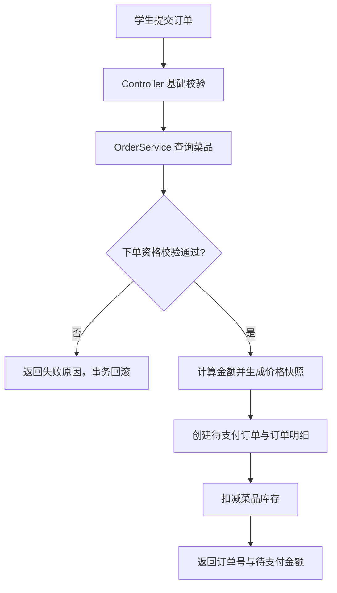
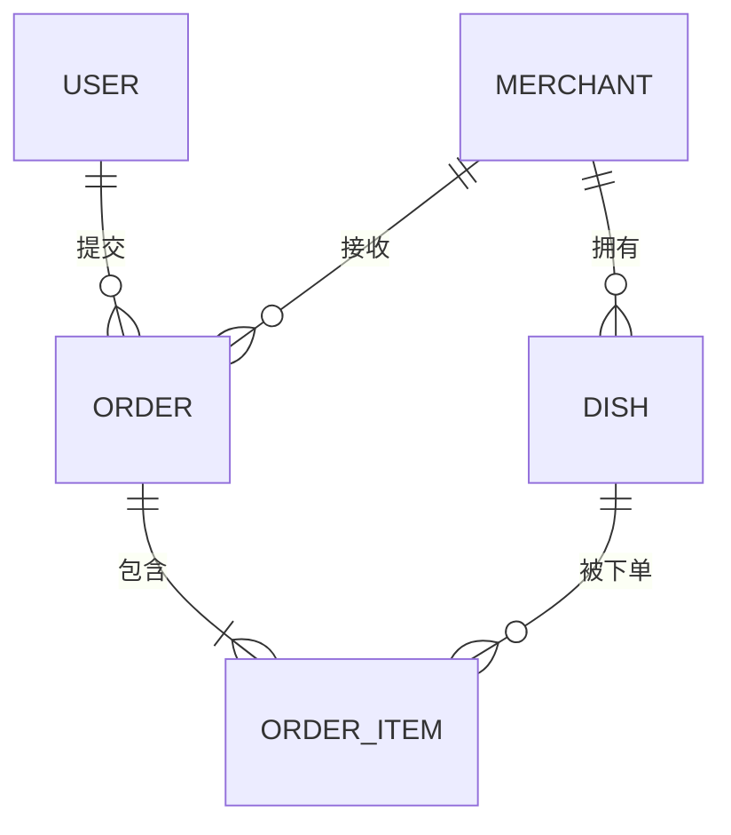

# 项目提案：校园外卖平台

## 0. 本周实现

本周先实现“**学生提交订单**”流程，该流程包含提交下单请求、校验菜品与库存，生成待支付订单并扣减库存的过程

### 0.1 业务流程：学生提交订单

涉及角色：学生、平台

主流程：

1. 学生提交订单，请求体必须包含 `userId`、`merchantId`、`items`、`deliveryAddress`，`remark` 为可选字段。`items` 为非空明细列表，每项只传入 `dishId` 和正整数 `quantity`；菜品名称、单价、明细小计和订单总金额均由服务端确定。本周 `userId` 从请求体传入，仅进行参数校验和记录，不查询用户表。
2. Controller 接收请求，完成必填项、数量格式等基础校验后调用 `OrderService.createOrder`。
3. `OrderService` 先按 `dishId` 合并重复菜品的购买，再查询菜品，根据合并后的数量执行下单资格校验。
4. 校验通过后，服务端按菜品当前单价计算每条明细的小计与订单总金额，生成价格快照。
5. 服务端生成标准带连字符格式的 UUID 作为 `orderNo`，创建 `Order`，状态置为 `待支付`。
6. 在同一事务内写入 `OrderItem` 并扣减菜品库存。
7. 返回订单号、订单总金额与待支付状态，等待支付。

异常流程：任一校验或库存扣减失败，整单回滚，不生成订单与明细，不扣减任何库存，并返回明确的失败原因。

结束状态：订单进入 `待支付`。

### 0.2 参与实体及其关系

本流程主要涉及 `Order`（订单）与 `Dish`（菜品）两个业务实体，二者通过 `OrderItem`（订单明细）关联；`User`（学生）与 `Merchant`（商家）作为支撑实体，本周先只记录其 id 即可。

| 实体 | 在本流程中的职责 | 关系 | 备注 |
|---|---|---|---|
| `Order` 订单 | 记录下单学生、商家、总金额、配送地址与订单状态 | N:1 `User`；N:1 `Merchant`；1:N `OrderItem` | 本周实现下单所需字段、待支付订单创建及订单查询 |
| `Dish` 菜品 | 提供菜品信息、单价、上架状态与库存 | N:1 `Merchant`；1:N `OrderItem` | 本周实现所需字段、上架菜品查询、下单校验和库存扣减 |
| `OrderItem` 订单明细 | 关联订单与菜品，保存下单时的名称、单价、数量与价格快照 | N:1 `Order`；N:1 `Dish` | 本周只作最小实现，支持订单关联与下单快照保存 |
| `User` 学生 | 订单的下单主体 | 1:N `Order` | 本周不实现，只作 `userId` 的记录 |
| `Merchant` 商家 | 订单的接单主体与菜品归属 | 1:N `Dish`；1:N `Order` | 本周不实现，只作 `merchantId` 的记录 |

关键关系说明：

- 核心关系是 `Order` 与 `Dish` 通过 `OrderItem` 形成 M:N：一条订单包含多条明细，一个菜品可以出现在多条订单中。
- `OrderItem` 保存 `orderId`、`dishId`、`dishName`、`unitPrice`、`quantity`、`subtotal`（只做最小实现，仅实现本周需要的字段），其中名称、单价与小计是下单时的快照，后续菜品改价不影响历史订单。
- `Order` 通过 `userId`、`merchantId` 关联学生与商家，本周不实现完整的用户和商家模块。

### 0.3 业务规则

**R1-下单资格校验**：在创建订单前，必须逐项校验菜品存在、属于请求中的商家、状态为上架、库存不少于购买数量。任一条件不满足时整单拒绝，不生成订单与订单明细，也不扣减任何库存。

校验失败场景：

| 场景 | 预期行为 |
|---|---|
| 菜品不存在 | 拒绝下单，返回菜品不存在 |
| 菜品不属于请求商家 | 拒绝下单，避免跨商家拼单 |
| 菜品已下架 | 拒绝下单，返回不可售原因 |
| 库存少于购买数量 | 拒绝下单，不写订单、不扣库存 |
| 多菜品中任一项失败 | 整单失败，事务回滚，其他菜品库存不变 |

注：

1. 空明细、数量小于等于 0 等属于请求参数校验，与上述 Service 业务规则区分处理。
2. 本周暂不处理并发下单和重复请求幂等问题。服务端生成 UUID 订单号，并通过数据库唯一约束保证订单号唯一，不代表已实现重复请求幂等。

## 1. 项目名称

校园外卖平台

## 2. 目标用户

| 用户角色 | 主要诉求 |
|---|---|
| 学生 | 浏览商家与菜单、加购下单、支付、跟踪配送进度、确认收货、评价与售后 |
| 校园商家、食堂窗口 | 管理店铺与菜单、设置营业状态、接单/拒单、出餐、处理退款、查看经营数据 |
| 兼职骑手 | 注册认证、接收配送任务、到店取餐、更新配送状态、查看收入 |
| 运营管理员 | 审核商家、管理用户与订单、处理投诉、发布公告、查看统计 |

## 3. 优先实现的业务场景

优先实现学生下单支付 → 商家接单的订单创建闭环，即订单履约主链路的前半段：

1. 学生浏览某商家的菜单，将菜品加入购物车并提交订单，系统创建待支付订单
2. 学生发起支付，系统记录支付结果（使用模拟支付）
3. 支付成功后，将已有订单更新为已支付状态，并通知商家接单
4. 商家接单或拒单；拒单则触发退款并关闭订单

订单状态流转：`待支付 → 已支付 → 已接单 / 已拒单`，另有 `已关闭` 作为异常与取消的终态。

week-04 先实现“学生提交订单”流程，支付、商家接单与退款留到后续周次。

## 4. 两个核心模型

以下模型说明包含后续演进内容，本周实现范围以“0. 本周实现”章节和 [week-04 文档](homework/week-04/index.md)为准。

### 4.1 订单（Order）

| 字段 | 说明 |
|---|---|
| id | 订单内部主键，使用自增 `BIGINT`，用于与订单明细关联 |
| orderNo | 使用 UUID |
| userId | 下单学生 |
| merchantId | 接单商家 |
| status | 订单状态：待支付 / 已支付 / 已接单 / 已拒单 / 已关闭 |
| totalAmount | 订单总金额 |
| deliveryAddress | 配送地址（宿舍楼、教学区等） |
| remark | 下单备注 |
| createdAt / paidAt / acceptedAt | 关键时间点 |

关键行为：创建订单、支付、商家接单/拒单、关闭订单。状态流转是订单模型的核心约束，非法流转应被拒绝。

### 4.2 菜品（Dish）

| 字段 | 说明 |
|---|---|
| id | 菜品主键 |
| merchantId | 所属商家 |
| name | 菜品名称 |
| category | 菜品分类，如主食、饮品 |
| price | 单价 |
| stock | 库存与售罄标记 |
| status | 上架 / 下架 |

关键行为：菜品上架与下架、库存扣减与售罄判断。

### 4.3 模型关系

- 一个商家拥有多个菜品（1:N）
- 一个学生可以创建多个订单（1:N）
- 订单与菜品通过订单明细关联（M:N），明细记录 orderId、dishId、数量与下单时单价
- 下单时按菜品单价生成明细金额快照，避免菜品改价影响历史订单

`User`、`Merchant` 作为支撑实体，本周先由 `Order` 以 id 引用；`OrderItem` 在下单流程中落地，完整的账户与商家模块在后续实现。
